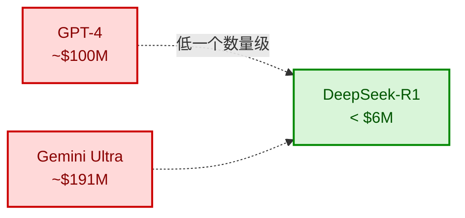
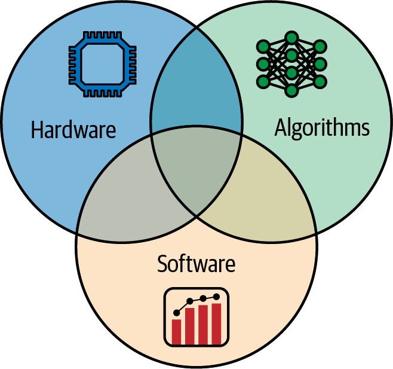
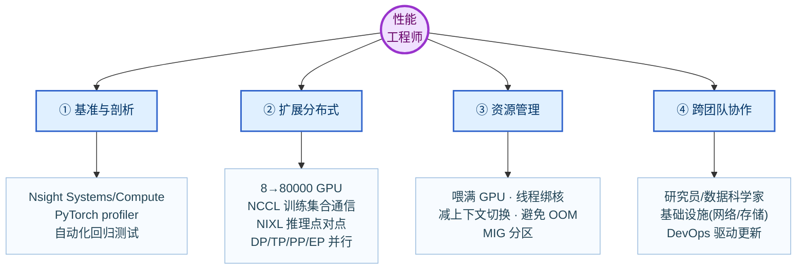
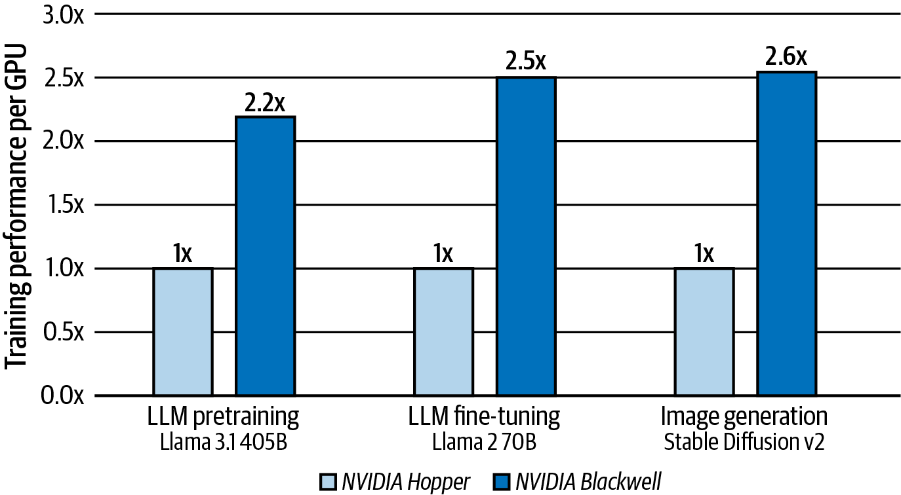
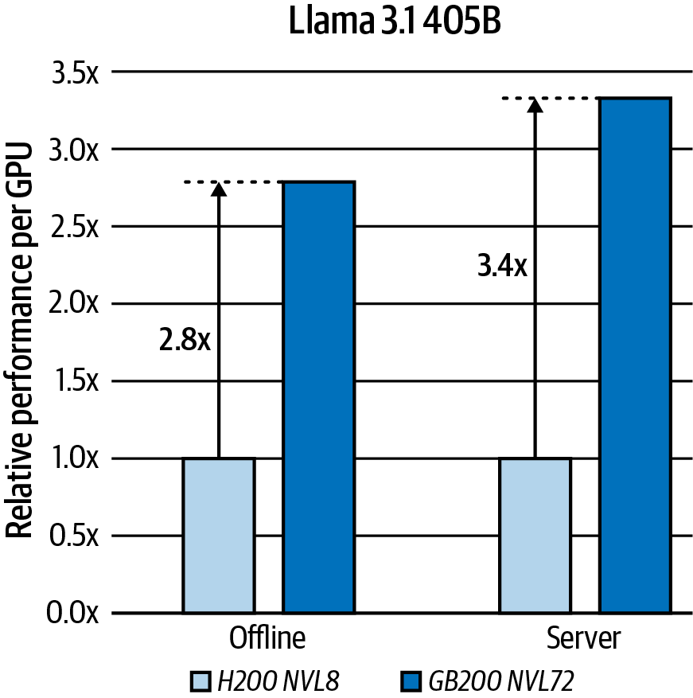
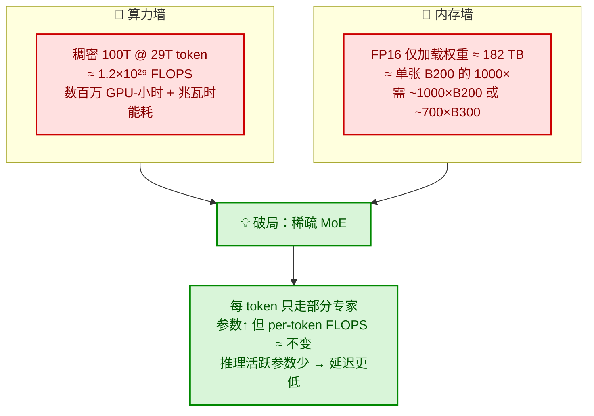
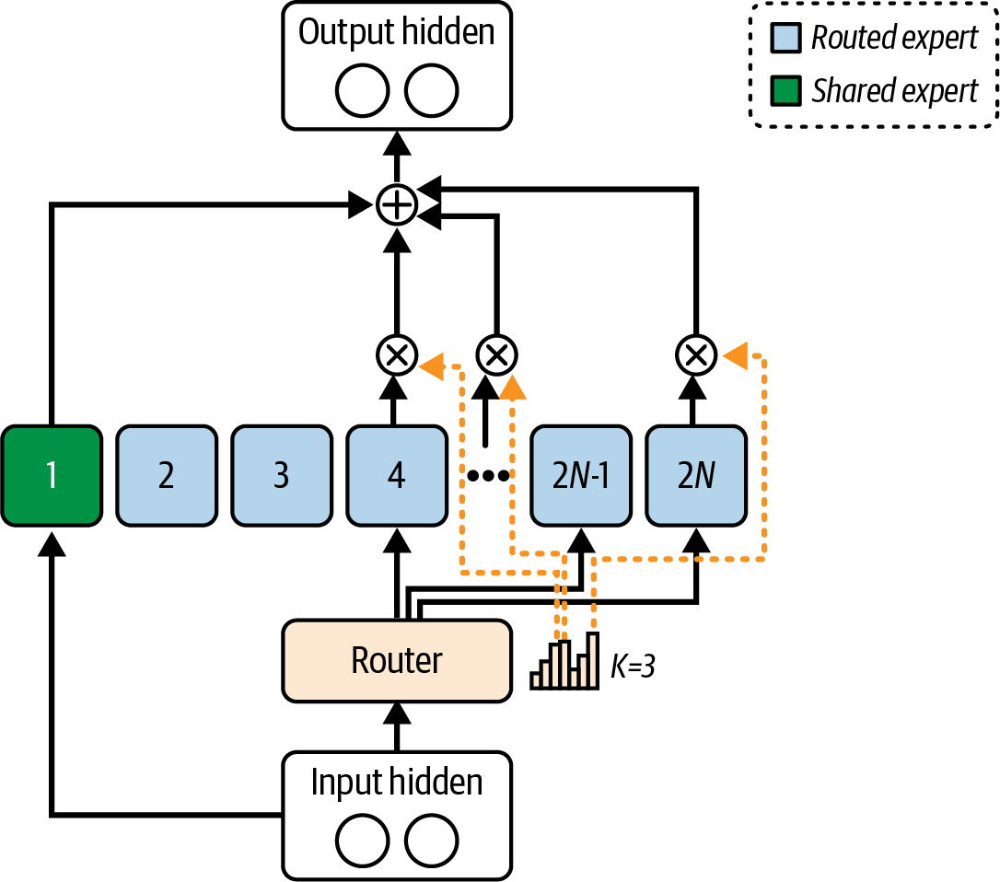
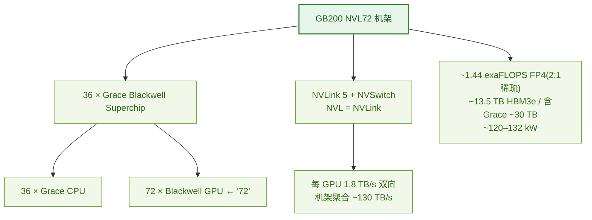
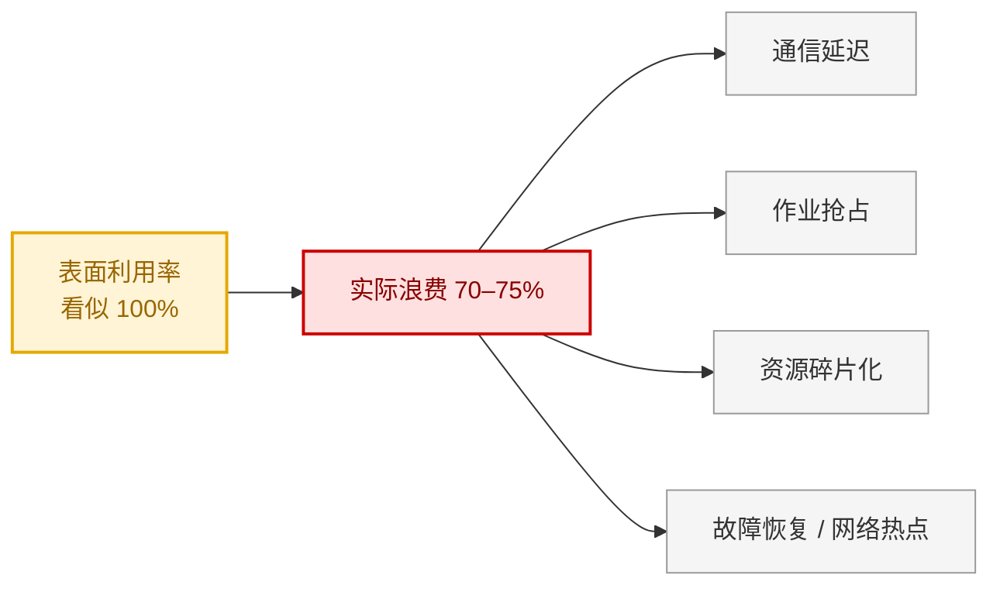
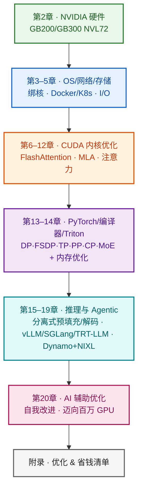

# 第 1 章 复习与自测 · 引言与 AI 系统概述

> **本笔记的用法**
> 第一部分「深度精读」按"是什么 → 为什么 → 怎么做 → 启示"四层重构全章，配书中原图；第二部分「自测」用分层题目检验你能否*讲清机制*而非*背下结论*。
> 建议流程：先盖住答案做自测 → 再读精读补漏 → 最后用文末「一页速查」做长期记忆锚点。

---

## 目录

- [0. 全章思想地图](#0-全章思想地图)
- [1. 开篇案例：DeepSeek 为什么是一记警钟](#1-开篇案例deepseek-为什么是一记警钟)
- [2. 性能工程师到底做什么](#2-性能工程师到底做什么)
- [3. 透明度与可复现：反对"vibe 优化"](#3-透明度与可复现反对-vibe-优化)
- [4. 100 万亿参数：算力墙与内存墙](#4-100-万亿参数算力墙与内存墙)
- [5. NVL72：把超算塞进一个机架](#5-nvl72把超算塞进一个机架)
- [6. 机械同情：协同设计的良性循环](#6-机械同情协同设计的良性循环)
- [7. Goodput：唯一真正重要的指标](#7-goodput唯一真正重要的指标)
- [8. 全书路线图](#8-全书路线图)
- [9. 分层自测](#9-分层自测)
- [10. 一页速查](#10-一页速查)

---

## 0. 全章思想地图

第 1 章不是零散知识点，而是一条**因果链**：因为暴力扩展撞墙（成本/内存/能耗），所以必须靠协同设计，而协同设计的成效用 goodput 衡量，性能工程师就是干这件事的人。


> **一句话主旨**：在超大规模下，"从系统里榨出的每一分性能都可能=省下数百万美元"，而这靠的是**硬件-软件-算法协同设计**，不是继续堆卡。

---

## 1. 开篇案例：DeepSeek 为什么是一记警钟

**是什么。** 2024 年底，DeepSeek 在被出口管制、只能用**阉割版 H800**（拿不到 H100/B200）的情况下，训出了逼近 GPT-4 水平的前沿模型，声称训练算力成本 **< $600 万**。消息一出，NVIDIA 单日股价一度跌 ~17%。

**为什么是警钟。** 它同时打脸了两种直觉：

| 直觉 | DeepSeek 的反证 |
|---|---|
| "前沿模型 = 最强硬件" | 阉割版 H800 也能训前沿模型 |
| "更强性能 = 更多钱" | 成本低一个数量级，性能却对标 GPT-4 |
| "带宽不够只能认命" | 把带宽当稀缺资源，逐字节优化通信 |

**成本对比一眼看清：**



> ⚠️ **别被数字骗了**：$6M 究竟只算"单次训练运行"还是含实验/数据流程存疑。原书态度是——**这正是要"测量一切、区分口径"的理由**，而不是拿来当营销话术。

**启示。** 约束不是终点，而是创新的催化剂。全书反复回到这个案例，因为它是"聪明工程 > 暴力投入"最生动的证据。

---

## 2. 性能工程师到底做什么

**是什么。** 一个横跨**硬件 + 软件 + 算法**三界的稀缺角色。这三者不是并列技能，而是必须**协同设计（codesign）**——这正是下图（书中图 1-1）的含义：



> **图 1-1 解读**：三个圆环交叠，价值在**交集**而非任一单圆。只懂 CUDA 不懂算法，或只调算法不懂内存层次，都无法定位真瓶颈。工程师的稀缺性正来自这块交集。

**四大职责（配典型动作与工具）：**



**深挖两个易混点：**

- **NCCL vs NIXL**：NCCL 面向*训练*的集合通信（all-reduce / all-gather / all-to-all）；NIXL 面向*分布式推理*的高吞吐低延迟**点对点**传输（跨 GPU 显存与存储层）。用途不同，别混。
- **"微调代码 = 巨大收益"的真实例子**：一个用 Python 写的数据预处理步骤能拖垮整条训练流水线；改用 C++ 或 NVIDIA cuPyNumeric（NumPy 直替，可把数组操作分布到 CPU+GPU）即可拆掉瓶颈。**瓶颈常在你以为无关紧要的地方。**

---

## 3. 透明度与可复现：反对"vibe 优化"

**核心原则。** *测量一切，信任数据而非假设。* 作者点名批评轶事式的 **"vibe 优化"**（"我们改了 X，感觉快了"），主张严谨科学方法：


**DeepSeek 开源周（2025.2）六大项目**——之所以重要，是因为"开源=可复现=可信"，同时按栈分层覆盖：

| 项目 | 栈层次 | 作用 |
|---|---|---|
| **FlashMLA** | 内核/算法 | 优化的注意力内核（CUDA C++） |
| **DeepGEMM** | 计算 | FP8 矩阵乘，稠密/稀疏均超多数厂商内核 |
| **DeepEP** | 通信 | MoE 专用通信库 |
| **EPLB** | 负载均衡 | 冗余专家：复制热点专家分担负载 |
| **DualPipe** | 并行调度 | 双向流水线，重叠计算/通信、减气泡 |
| **3FS** | 存储 | 高性能分布式文件系统 |

> **关键洞察**：连*文件系统*都要优化——说明"每一层都可能是瓶颈"，没有可以偷懒的一层。

**MLPerf 的正确读法。** MLPerf 是跨软硬件的可复现基准。但作者提醒：**per-GPU 数值只是组件级指标，跨平台比较必须用系统级端到端吞吐**（因为不同平台的 NVLink 域大小、GPU 数不同，单卡数会误导）。

书中用两张图量化了 Blackwell 相对 Hopper 的代际提升（每 GPU）：





> **图 1-2/1-3 解读**：GB200 NVL72 相对等效 Hopper 集群，训练每 GPU **2.6×**、推理 **~3.4×**。推理提升更大，得益于更高的单卡性能 **+ 更大的 NVLink 域**（呼应第 5 节）。但记住作者的告诫——**这是 per-GPU 组件级读数，跨平台下结论要看系统级端到端吞吐**。

---

## 4. 100 万亿参数：算力墙与内存墙

**为什么盯着 100T。** 对标人脑新皮层约 100 万亿突触。理论可行，但暴力扩展对除巨头外的所有人都不现实——因为撞上**两堵墙**：



**内存墙的算术（务必会算）：**

```
182 TB = 100万亿 参数 × 16 bit/参数 ÷ 8 bit/字节
```

而且这**只是加载权重**，还没算激活、优化器状态、推理输入——实际需求更大。

**MoE 为什么能破墙。** 稠密模型每 token 激活*全部*参数；MoE 只把 token 路由到少数专家子集，于是**总参数增长 ≠ 每 token 算力增长**。案例：Google Switch Transformer（1.6T 参数）用一小部分算力达到稠密模型同等精度，**训练快 7×**。

DeepSeek-V3 的具体路由如下（书中图 1-4）：每个 token = **1 个共享专家 + 从 256 个里路由选出 8 个** = 9 个活跃专家，于是 ~6800 亿总参数里每 token 只激活 ~370 亿。



> **图 1-4 解读**：token 进来后由**路由器（router）**打分，只点亮少数专家，其余专家"休眠"不参与本次前向。这就是"稀疏激活"——总容量巨大，单次计算却很省。

---

## 5. NVL72：把超算塞进一个机架

**是什么。** NVIDIA 对超大规模的硬件应答：GB200/GB300 NVL72——NVIDIA 直接称其为"机架里的 AI 超级计算机"。

**名字拆解 & 构成：**



**一个高频陷阱：NVLink 是"池化"但*不是*统一均匀内存。**
- NVLink 把 72 个 GPU 连成一个高速域，CUDA 统一内存可跨 NVLink 迁移/远程访问页面；
- **但**远程访问的延迟/带宽与本地不同，应视为**非均匀（NUMA-like）**；
- 跨 Grace-Blackwell 的托管分配，建议用 `cudaMemPrefetchAsync` / `cudaMemAdvise` **显式预取**，减少缺页停顿。

> 别把"整机架"当成一块巨大的均匀显存来推理性能——这是新手最容易踩的坑。

---

## 6. 机械同情：协同设计的良性循环

**术语来源。** *Mechanical Sympathy*（Martin Thompson 提出，类比 F1 车手 Jackie Stewart 深谙车辆机械）——写**深度理解底层硬件**的软件。

**两个经典算法（都在"减少内存搬运"上做文章）：**

| 算法 | 核心手法 | 收益 |
|---|---|---|
| **FlashAttention** | 对注意力"分块（tiling）"，最小化 GPU 显存读写 | 长序列训练/推理 **2–4×**，降内存；几乎一夜成为库默认 |
| **DeepSeek MLA**（多头潜在注意力） | 重构注意力以更好利用内存层次 + Tensor Core | 在 H800 上**甚至超过 FlashAttention** |

**为什么说"整本书都是机械同情的研究"——因为它是一个良性循环：**


> **具体例证**：softmax 曾是 transformer 注意力在旧 GPU 上的瓶颈 → NVIDIA 在 SFU 里加**专用指数计算单元**加速它 → 又让研究者敢用更复杂的注意力变体。硬件与算法互相"喂招"。

---

## 7. Goodput：唯一真正重要的指标

**问题。** 传统 FLOPS/利用率**误导性偏高**——GPU 显示"100% 忙"，但可能忙在通信停滞、空闲等待、失败重启上。NVIDIA 把理论上限叫 **"光速（speed of light）"**。

**定义。** Goodput = 单位时间完成的**有用工作**（处理的 token / 完成的推理请求），扣除一切无效开销；除以峰值即效率百分比。

**必会计算（书中例）：**

```
8 GPU 节点，10 秒处理 100,000 token
  goodput = 100,000 / 10 = 10,000 tok/s
  峰值    = 8 × 1,500   = 12,000 tok/s
  效率    = 10,000 / 12,000 = 83.3%
```

**Meta《Revisiting Reliability》的震撼结论：**



**怎么补差距（对症下药）：**

| 症状 | 处方 |
|---|---|
| GPU 等存储数据 | 缓存 / 异步预取 |
| 梯度同步时 GPU 空闲 | 让**计算与通信重叠**（全书反复出现的模式） |

**价值主张。** 工程师的使命就是把 goodput 尽量推向 100%。**20% 的集群效率提升，在大规模下 = 省数百万美元**——这就是"为什么这个岗位拿顶薪"。

---

## 8. 全书路线图

从硬件地基一路向上到算法，每层都强调动手实测：



---

## 9. 分层自测

> 先独立作答，再点开 `<details>` 对照。答案强调**说清机制**。

### A · 概念（讲清"为什么"）

<details>
<summary><b>Q1.</b> 为什么 FLOPS 利用率"误导性偏高"？goodput 的本质区别是什么？</summary>

利用率只反映 GPU"在忙"，但忙的内容可能是通信停滞、空闲等待、失败重启等**无效开销**。goodput 只计**真正推进训练/推理的有用工作**（token/请求），因此才是端到端真实效率。Meta 证明：利用率看似 100% 时，仍可能 70–75% 算力被浪费。
</details>

<details>
<summary><b>Q2.</b> 用自己的话讲"机械同情"，并说明为何它是全章内核。</summary>

机械同情 = 写深度理解底层硬件的软件，让算法与硬件能力协同设计。它是内核，因为全章展示了一个**双向良性循环**：硬件能力/限制催生新算法（FlashAttention、MLA），新算法又反推硬件创新（Transformer Engine、SFU 指数单元）。单靠任一层都到不了超大规模效率。
</details>

<details>
<summary><b>Q3.</b> MoE 为何能"总参数暴涨但每 token 算力几乎不变"？对推理延迟有何影响？</summary>

因为每个 token 只被路由到少数专家子集，而非激活全部参数，所以 per-token FLOPS 大致恒定。推理时活跃参数更少 → 延迟通常显著低于同规模稠密模型。
</details>

<details>
<summary><b>Q4.</b> 为什么 MLPerf 的 per-GPU 数值不能作为跨平台主指标？</summary>

不同平台的 GPU 数量、NVLink 域大小不同，单卡数会掩盖系统级协同效应。正确基础是**系统级端到端吞吐**，per-GPU 仅作组件级参考。
</details>

### B · 案例（还原"怎么做"）

<details>
<summary><b>Q5.</b> DeepSeek 面对 H800 的关键劣势是什么？用了哪些手段克服？</summary>

**关键劣势**：NVLink 带宽被削到 ~400 GB/s（H100 ~900 GB/s），限制多 GPU 扩展。
**手段**：① DualPipe 双向流水线并行重叠计算/通信；② 自定义 CUDA 内核**绕过默认 NCCL 集合通信**，让传输与计算并行，低带宽下仍喂满 GPU；③ MoE 架构降低每 token 有效算力；④ R1 用"冷启动 + 强化学习"减少人工标注。
</details>

<details>
<summary><b>Q6.</b> 列举开源周 4 个项目并各归到栈的哪一层，点出背后洞察。</summary>

FlashMLA（内核）、DeepGEMM（计算）、DeepEP（通信）、EPLB（负载均衡）、DualPipe（并行调度）、3FS（存储）任选 4 个。
**洞察**：连文件系统都要优化——**每一层都可能是瓶颈**。
</details>

<details>
<summary><b>Q7.</b> 为什么"暴力扩到 100T 参数"不现实？给破局思路。</summary>

**算力墙**：稠密 100T@29T token ≈ 1.2×10²⁹ FLOPS，数百万 GPU-小时 + 兆瓦时能耗。
**内存墙**：FP16 仅加载权重 ≈ 182 TB ≈ 单张 B200 的 1000×，需 ~1000×B200 / ~700×B300，还没算激活/优化器状态。
**破局**：稀疏 MoE + 硬件-软件-算法协同设计，而非堆卡。
</details>

### C · 计算（动手算）

<details>
<summary><b>Q8.</b> 4 GPU 节点，每 GPU 峰值 2,000 tok/s；实测 8 秒处理 51,200 token。求 goodput 与效率。</summary>

goodput = 51,200 / 8 = **6,400 tok/s**；峰值 = 4 × 2,000 = 8,000；效率 = 6,400 / 8,000 = **80%**。
</details>

<details>
<summary><b>Q9.</b> 理想 1,000 样本/s，实测 250。goodput？浪费多少？两类处方？</summary>

goodput = **25%**，浪费 **75%**。处方：① 卡数据加载 → 缓存/异步预取；② 卡梯度同步 → 计算与通信重叠。
</details>

<details>
<summary><b>Q10.</b>（推导）验证 100T 参数 FP16 ≈ 182 TB 的算式。</summary>

100×10¹² 参数 × 16 bit ÷ 8 bit/字节 = 200×10¹² 字节 ≈ 182 TiB（按 1 TiB=2⁴⁰）。关键：**这只是权重**，激活/优化器状态另算。
</details>

### D · 开放（内化思想）

<details>
<summary><b>Q11.</b> 谈谈性能工程师的价值主张，为什么"堆卡不够"。</summary>

价值 = 弥合"理论性能 vs 实际 goodput"的差距。规模下增量优化产生数量级经济影响（20% 效率 = 省数百万）。需全栈视角 + profile-driven + 协同设计。DeepSeek 证明熟练工程胜过暴力投入。
</details>

<details>
<summary><b>Q12.</b> 举一个本章之外"硬件↔软件互推"的例子。</summary>

开放题。评估点：能否描述"硬件能力/限制 → 新算法 → 反推下一代硬件"的双向链并联系性能收益。例：Tensor Core 低精度支持 → 混合精度/量化普及 → 推动更强低精度单元。
</details>

---

## 10. 一页速查

**六大关键要点**

1. **测量 goodput** —— 超越 FLOPS/利用率，看有效计算占比。
2. **熟练工程 > 暴力投入** —— 硬件不是银弹（DeepSeek）。
3. **增量优化找数量级影响** —— 规模下小低效悄悄放大。
4. **profile-driven 心态** —— 用数据定位真瓶颈再对症下药。
5. **全局（holistic）视角** —— 任一层弱点都拖垮整体；重协同设计。
6. **持续跟进软硬件+算法** —— 新能力改变最优策略；善用 MLPerf。

**关键数字**

| 项 | 值 |
|---|---|
| GPT-4 / Gemini Ultra / DeepSeek-R1 训练成本 | ~$100M / ~$191M / <$6M |
| H100 vs H800 NVLink 带宽 | ~900 vs ~400 GB/s |
| DeepSeek-V3 总参 / 每 token 活跃 | ~6800 亿 / ~370 亿（1共享+8路由/256） |
| 100T FP16 权重显存 | ~182 TB（≈B200 的 1000×） |
| NVL72 | 36 Grace + 72 Blackwell；每 GPU 1.8 TB/s；聚合 ~130 TB/s；~1.44 exaFLOPS FP4；~30 TB；~120–132 kW |
| MLPerf v5.0 GB200 vs Hopper（每 GPU） | 训练 2.6× / 推理 ~3.4× |

**术语**：Goodput｜机械同情｜MoE｜NCCL(训练集合)/NIXL(推理点对点)｜FlashAttention/MLA｜DualPipe｜NVLink/NVSwitch｜MIG｜DP/FSDP/TP/PP/CP/EP｜光速(理论上限)

**自查清单**

- [ ] 能画出全章因果链（问题→协同设计→硬件→goodput→角色）
- [ ] 能算 goodput 效率，并说出两类补差处方
- [ ] 能还原 DeepSeek 克服 H800 的 3+ 手段
- [ ] 能解释 MoE 破"两堵墙"的机制
- [ ] 能说清"NVLink 池化 ≠ 统一均匀内存"
- [ ] 能用 FlashAttention/MLA 讲机械同情的良性循环
