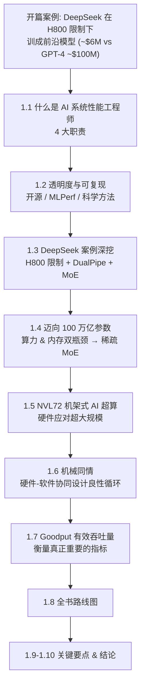

# 第1章 复习与自测：引言与AI系统概述

> 用途：读完第1章后的结构化复习 + 自测。建议先读「知识总结」梳理骨架，再做「自测题」检验吸收，最后对照答案查漏补缺。

---

## 一、一句话主旨

**在超大规模 AI 时代，单纯"堆硬件"既不经济也不可持续；真正的突破来自硬件、软件、算法的协同设计（机械同情），而 AI 系统性能工程师正是把"理论算力"转化为"有效产出（goodput）"的关键角色。** DeepSeek 在受限 H800 GPU 上训练出前沿模型，就是这一论点的最佳注脚。

---

## 二、章节逻辑脉络

核心叙事：**案例引入（为什么重要）→ 角色定义（谁来做）→ 方法论（怎么做：透明可复现）→ 挑战（100万亿参数）→ 硬件应答（NVL72）→ 思想内核（机械同情）→ 衡量标准（goodput）→ 全书地图。**

---

## 三、分节要点提炼

### 1.1 AI 系统性能工程师
性能工程师融合**硬件 + 软件 + 算法**三方专业知识，需理解 OS、内存层次、网络、Python/C++、PyTorch/Triton/CUDA。四大职责：

1. **基准测试与性能分析（Benchmarking & Profiling）**：用 Nsight Systems / Nsight Compute / PyTorch profiler 迭代定位瓶颈；建立自动化性能测试以尽早捕获回归。
2. **扩展分布式训练与推理**：从 8 GPU 扩到 80,000 GPU 时保持低开销；用 NCCL（训练集合通信，如 all-reduce）、NIXL（分布式推理点对点传输）；运用数据/张量/流水线/专家并行。
3. **高效管理资源**：喂满 GPU、线程绑核、减少上下文切换、避免 OOM；用 MIG 分区 GPU 提升利用率。
4. **跨团队协作**：与研究员、数据科学家、基础设施（网络/存储）、DevOps 协同——性能改进常跨多个团队。

> 关键理念：三种专业化必须**协同设计（codesign）**，而非孤立优化。

### 1.2 透明度与可复现
- 原则：**测量一切，信任数据而非假设**；反对轶事式"vibe 优化"，提倡"假设→可复现基准测量→调整→重跑→分享"的科学方法。
- DeepSeek 开源周（2025.2）六大项目：**FlashMLA**（注意力内核）、**DeepGEMM**（FP8 矩阵乘）、**DeepEP**（MoE 通信库）、**EPLB**（冗余专家负载均衡）、**DualPipe**（双向流水线并行）、**3FS**（分布式文件系统）。
- **MLPerf** 提供跨软硬件的可复现基准。注意：**per-GPU 数值只是组件级指标，跨平台应以系统级端到端吞吐为准**。

### 1.3 DeepSeek 在 H800 限制下扩展到 ~6800 亿参数
- H800 是 Hopper 出口合规版：**NVLink 带宽 ~400 GB/s（vs H100 ~900 GB/s）**、FP64 降低，HBM 容量/带宽基本保留。
- DeepSeek-V3：**~6800 亿总参数，每 token 仅激活 ~370 亿**（1 共享专家 + 8 路由专家，选自 256 个 = 9 活跃专家）。
- 手段：**DualPipe 并行 + 自定义 CUDA 内核绕过默认 NCCL 集合通信**，实现**计算/通信重叠**掩盖带宽劣势。
- DeepSeek-R1：在 V3 基础上用"**冷启动 + 强化学习**"嵌入链式思维推理，少依赖人工标注，进一步省钱省时。
- 结论：**聪明的软件/算法设计战胜暴力硬件限制**。

### 1.4 迈向 100 万亿参数模型
- 里程碑对标人脑新皮层约 100 万亿突触连接。
- **双瓶颈**：
  - 算力：稠密模型（~29 万亿 token）约需 1.2×10²⁹ FLOPS。
  - 内存：FP16 下 100 万亿参数需 **~182 TB** 显存（≈单张 B200 的 1000 倍），仅加载权重就需 ~1000 张 B200 或 ~700 张 B300。
- 破局：**稀疏 MoE**——每 token 只走部分专家，总参数增长而 per-token FLOPS 大致不变；推理时活跃参数少 → 延迟更低。案例：Google Switch Transformer（1.6 万亿参数，训练快 7×）。

### 1.5 NVIDIA "机架式 AI 超级计算机"（NVL72）
- GB200/GB300 NVL72：**36 个 Grace Blackwell Superchip = 36 Grace CPU + 72 Blackwell GPU**（"72"即 GPU 数）。
- NVL = NVLink；通过 **NVSwitch** 组成机架级交换结构，每 GPU **1.8 TB/s** 双向 NVLink 5，机架聚合 **~130 TB/s**。
- 单机架理论：**~1.44 exaFLOPS（FP4，2:1 稀疏）**、~720 petaFLOPS（FP8）；**~13.5 TB HBM3e**（含 Grace 内存共约 30 TB）；功率 ~120–132 kW。
- 注意：NVLink 是**池化但非均匀内存**，远程访问延迟/带宽不同；跨 Grace-Blackwell 托管分配建议用 `cudaMemPrefetchAsync` / `cudaMemAdvise` 显式预取。

### 1.6 机械同情：硬件-软件协同设计
- **机械同情（Mechanical Sympathy）**：Martin Thompson 提出，类比赛车手 Jackie Stewart 深谙车辆机械；即编写深度理解底层硬件的软件。
- **FlashAttention**：对注意力计算"分块（tiling）"，最小化 GPU 内存读写 → 长序列训练/推理 **2–4× 加速**且降内存。
- **DeepSeek MLA（多头潜在注意力）**：重构注意力以更好利用内存层次和 Tensor Core，在 H800 上甚至超过 FlashAttention。
- **良性循环**：transformer + 低精度量化（FP8/FP4）→ NVIDIA 加 Transformer Engine / 低精度 Tensor Core / SFU（如加速 softmax 的指数单元）→ 催生新算法 → 再推动硬件……

### 1.7 测量 Goodput（有效吞吐量）
- 传统 FLOPS/利用率**误导性偏高**（时间常耗在通信停滞、空闲、失败重启）。
- **Goodput = 单位时间完成的有用工作**（处理的 token / 完成的推理请求），扣除一切无效开销；可除以峰值吞吐得到效率百分比。
- NVIDIA 称理论上限为"**光速（speed of light）**"。
- **计算示例**：8 GPU 节点 10 秒处理 100,000 token → goodput 10,000 tok/s；峰值 8×1,500 = 12,000 tok/s → 效率 **83.3%**。
- Meta《Revisiting Reliability》提出"**有效训练时间比率**"：即便利用率看似 100%，也可能 70–75% 算力因通信延迟、抢占、碎片化、故障恢复而损失。
- 价值主张：性能工程师的使命是把 goodput 尽量推向 100%；**20% 集群效率提升 = 大规模下省数百万美元**。

### 1.8 全书路线图（速记）
| 章节 | 主题 |
|------|------|
| 第2章 | NVIDIA 硬件（GB200/GB300 NVL72） |
| 第3–5章 | OS / 网络 / 存储优化（CPU 内存绑定、Docker、K8s、I/O） |
| 第6–12章 | CUDA 编程与内核优化（FlashAttention、MLA、注意力机制） |
| 第13–14章 | PyTorch 优化、编译器、Triton；并行技术 DP/FSDP/TP/PP/CP/MoE；内存优化（激活检查点、分片优化器、CPU 卸载） |
| 第15–19章 | 高吞吐低延迟推理、Agentic AI；分离式预填充/解码、vLLM/SGLang/TensorRT-LLM、NVIDIA Dynamo + NIXL |
| 第20章 | AI 辅助优化、自我改进系统、迈向百万 GPU 集群 |
| 附录 | 性能优化与省钱清单 |

### 1.9–1.10 关键要点（六条）
1. **测量 goodput**——超越 FLOPS/利用率，关注有效计算占比。
2. **优先熟练的工程优化而非暴力投入**——硬件不是银弹（DeepSeek 例证）。
3. **在增量优化中寻找数量级影响**——规模下小低效悄悄放大成本。
4. **以性能分析驱动（profile-driven）的心态调优**——用数据定位真瓶颈再针对性优化。
5. **保持全局视角（holistic）**——任一层的弱点都会成为整体瓶颈；重视硬件-软件协同设计。
6. **持续跟进最新软硬件与算法**——新能力会改变最优策略；善用 MLPerf。

---

## 四、关键数字速记表

| 项目 | 数值 |
|------|------|
| GPT-4 训练成本（报道） | ~$100M |
| Gemini Ultra 训练成本（估计） | ~$191M |
| DeepSeek-R1 训练算力成本（声称） | < $6M |
| DeepSeek 消息致 NVIDIA 单日股价跌幅 | ~17% |
| H100 NVLink 带宽 / GPU | ~900 GB/s |
| H800 NVLink 带宽 / GPU | ~400 GB/s |
| H100 内存带宽 | 3.35 TB/s |
| DeepSeek-V3 总参数 / 每 token 活跃 | ~6800 亿 / ~370 亿 |
| DeepSeek-V3 专家配置 | 1 共享 + 8 路由（选自 256）= 9 活跃 |
| 100 万亿参数 FP16 显存需求 | ~182 TB（≈单张 B200 的 1000×） |
| 加载 100 万亿模型所需 GPU | ~1000 张 B200 / ~700 张 B300 |
| NVL72 组成 | 36 Grace CPU + 72 Blackwell GPU |
| NVL72 每 GPU NVLink 5 带宽 | 1.8 TB/s 双向 |
| NVL72 机架聚合带宽 | ~130 TB/s |
| NVL72 FP4 峰值 | ~1.44 exaFLOPS（2:1 稀疏） |
| NVL72 HBM3e / 含 Grace 总内存 | ~13.5 TB / ~30 TB |
| NVL72 机架功率 | ~120–132 kW |
| MLPerf Training v5.0 GB200 vs Hopper（每 GPU） | 2.6× |
| MLPerf Inference v5.0 GB200 vs Hopper（每 GPU） | ~3.4× |

---

## 五、核心术语表

| 术语 | 含义 |
|------|------|
| **Goodput（有效吞吐量）** | 单位时间完成的"有用工作"，扣除无效开销；衡量真实效率的核心指标 |
| **机械同情（Mechanical Sympathy）** | 编写深度理解底层硬件的软件；硬件-软件-算法协同设计 |
| **MoE（混合专家）** | 稀疏模型，每 token 仅激活部分专家，总参数增长而 per-token 算力大致不变 |
| **NCCL** | NVIDIA 集合通信库，用于 all-reduce/all-gather/all-to-all 等训练集合操作 |
| **NIXL** | NVIDIA Inference Xfer Library，分布式推理的高吞吐低延迟点对点传输 |
| **FlashAttention** | 分块（tiling）注意力算法，最小化显存读写，2–4× 加速 |
| **MLA（多头潜在注意力）** | DeepSeek 重构注意力算法，更好利用内存层次与 Tensor Core |
| **DualPipe** | DeepSeek 双向流水线并行，重叠前后向计算与通信，减少流水线气泡 |
| **NVLink / NVSwitch** | GPU 间高速互连 / 机架级 NVLink 交换结构 |
| **MIG（多实例 GPU）** | GPU 虚拟化，分区资源提升整体利用率 |
| **NVL72** | 72-GPU NVLink 域的机架式 AI 超算（GB200/GB300） |
| **并行技术** | DP（数据）、FSDP（全分片数据）、TP（张量）、PP（流水线）、CP（上下文）、EP（专家）、MoE |
| **Transformer Engine / Tensor Core / SFU** | 针对 transformer、矩阵数学、特殊函数（如 softmax 指数）的专用硬件单元 |
| **光速（Speed of Light）** | NVIDIA 术语，指理论硬件性能上限 |

---

## 六、自测题

> 建议先合上总结独立作答，再点开答案对照。答案用折叠块隐藏。

### A. 概念理解题

**Q1.** 为什么说传统的 FLOPS 利用率指标"误导性偏高"？goodput 与它的本质区别是什么？

??? note "参考答案"
    利用率高只说明 GPU 在"忙"，但忙的内容可能是通信停滞、空闲等待、失败重启等**无效开销**。goodput 只计入**真正推进训练/推理的有用工作**（如前后向计算、完成的推理请求），因此更能反映系统的真实端到端效率。Meta 指出，即便利用率看似 100%，也可能 70–75% 算力被浪费。

**Q2.** 用自己的话解释"机械同情（mechanical sympathy）"，并说明它为何是全书的核心思想。

??? note "参考答案"
    机械同情指编写深度理解底层硬件特性的软件，使算法与硬件能力协同设计以榨取最大性能（类比深谙赛车机械的车手）。它是全书核心，因为整本书都在展示：新硬件能力/限制催生新算法，新算法又反推硬件创新，形成良性循环——单靠任一层都无法达到超大规模的效率要求。

**Q3.** MoE（混合专家）模型为什么能在"总参数暴涨"的同时不让"每 token 计算量"同比暴涨？这对推理延迟有何影响？

??? note "参考答案"
    因为每个输入 token 只被路由到少数几个专家（子集），而非激活全部参数，所以 per-token FLOPS 大致恒定，即便总参数增长。推理时活跃参数更少，因此 MoE 的请求-响应延迟通常显著低于同规模稠密模型。

**Q4.** 为什么 MLPerf 提醒"per-GPU 数值不应作为跨平台的主要指标"？正确的比较基础是什么？

??? note "参考答案"
    因为不同平台的 GPU 数量、互连规模（如 NVLink 域大小）不同，单看 per-GPU 会忽略系统级协同效应。正确基础是**系统级、端到端吞吐量**；per-GPU 仅作组件级参考指标。

**Q5.** "透明度与可复现"为何对性能工程如此重要？作者反对的是哪种做法？

??? note "参考答案"
    因为性能工程应"测量一切、信任数据"，公开工作让他人可复现、验证、在此基础上改进（如 DeepSeek 开源周、MLPerf）。作者反对**轶事式"vibe 优化"**（"我们做了 X，感觉更快了"），提倡"假设→可复现基准测量→调整→重跑→分享"的严谨科学方法。

### B. 案例分析题

**Q6.** DeepSeek 面对 H800 的哪一项关键硬件劣势？它用了哪些具体技术手段来克服？

??? note "参考答案"
    关键劣势：**NVLink 互连带宽被削减到 ~400 GB/s（H100 为 ~900 GB/s）**，限制多 GPU 可扩展性。手段：(1) **DualPipe 双向流水线并行**重叠计算与通信；(2) **自定义 CUDA 内核绕过默认 NCCL 集合通信**，协调数据传输与计算并行，从而在低带宽下保持 GPU 高利用率；(3) 采用 **MoE 架构**减少每 token 有效计算；(4) R1 用"冷启动+强化学习"减少人工标注成本。

**Q7.** 列举 DeepSeek 开源周发布的项目中至少四个，并说明它们分别针对 AI 系统栈的哪一层。

??? note "参考答案"
    - **FlashMLA**：注意力内核（算法/内核层）
    - **DeepGEMM**：FP8 矩阵乘法库（计算/内核层）
    - **DeepEP**：MoE 通信库（通信层）
    - **EPLB**：冗余专家负载均衡（调度/负载层）
    - **DualPipe**：双向流水线并行算法（并行/训练调度层）
    - **3FS**：高性能分布式文件系统（存储层）
    
    要点：说明"每一层——包括文件系统——都需优化"。

**Q8.** 为什么"暴力扩展到 100 万亿参数"对绝大多数组织不可行？至少从算力和内存两方面说明，并给出破局思路。

??? note "参考答案"
    - **算力**：稠密 100 万亿参数（~29 万亿 token）约需 1.2×10²⁹ FLOPS，训练需数百万 GPU 小时与兆瓦时能耗。
    - **内存**：FP16 下仅加载权重就需 ~182 TB 显存（≈单张 B200 的 1000 倍），约需 1000 张 B200 或 700 张 B300，还未算激活/优化器状态；GPU 间通信开销随分区急剧上升。
    - **破局**：稀疏 **MoE**（降低有效算力）+ 硬件-软件-算法协同设计，而非单纯堆硬件。

### C. 计算题

**Q9.** 某节点有 4 个 GPU，每个 GPU 峰值 2,000 token/s。实测该节点 8 秒处理了 51,200 个 token。求 goodput 与效率百分比。

??? note "参考答案"
    - goodput = 51,200 / 8 = **6,400 token/s**
    - 峰值 = 4 × 2,000 = 8,000 token/s
    - 效率 = 6,400 / 8,000 = **80%**

**Q10.** 一个训练作业理想吞吐 1,000 样本/秒，实测仅 250 样本/秒。goodput 是多少？浪费了多少容量？可能的两类改进方向？

??? note "参考答案"
    - goodput = 250 / 1,000 = **25%**，浪费 **75%** 容量。
    - 改进方向举例：(1) 若卡在数据加载 → 引入**缓存 / 异步预取**；(2) 若卡在梯度同步空闲 → 将 **GPU 计算与 GPU 间通信重叠**。

### D. 开放思考题

**Q11.** 作者反复强调"我们不能只向扩展问题投入硬件"。结合本章，谈谈你如何理解性能工程师的价值主张。

??? note "参考答案要点"
    - 价值 = 弥合"理论性能 vs 实际 goodput"的差距。
    - 规模下增量优化产生数量级经济影响（20% 效率 = 省数百万美元）。
    - 需跨硬件/软件/算法的全栈视角 + 性能分析驱动 + 协同设计思想。
    - DeepSeek 证明熟练工程可胜过暴力投入。

**Q12.** 举一个本章之外你能想到的"硬件催生软件 / 软件反推硬件"的例子，说明它如何体现机械同情的良性循环。

??? note "参考答案要点"
    开放题，无标准答案。评估要点：能否清晰描述"硬件能力/限制 → 新算法或软件设计 → 反过来推动下一代硬件"的双向因果链，并联系到性能收益。（例如：Tensor Core 的低精度支持 → 混合精度训练/量化算法普及 → 又推动更强的低精度硬件单元。）

---

## 七、自查清单

读完本章后，确认自己能否不看笔记回答：

- [ ] 说出 AI 系统性能工程师的四大职责
- [ ] 解释 goodput 的定义、算法，并做一道效率计算
- [ ] 复述 DeepSeek 在 H800 限制下的 3+ 项关键技术
- [ ] 说明 MoE 为何能在参数暴涨时控制 per-token 算力
- [ ] 描述 NVL72 的基本构成与"NVL72"名称含义
- [ ] 用一句话解释机械同情，并举出 FlashAttention/MLA 为例
- [ ] 列出六条关键要点
