# 第 2 章 复习与自测 · AI 系统硬件概述

> **本笔记的用法**
> 第一部分「深度精读」按"是什么 → 为什么 → 怎么做 → 启示"四层重构全章，配书中原图；第二部分「自测」用分层题目检验你能否*讲清机制*而非*背下结论*。
> 建议流程：先盖住答案做自测 → 再读精读补漏 → 最后用文末「一页速查」做长期记忆锚点。

---

## 目录

- [0. 全章思想地图](#0-全章思想地图)
- [1. 超级芯片：CPU + GPU 合二为一](#1-超级芯片cpu--gpu-合二为一)
- [2. Grace CPU：不抢戏的"喂数据官"](#2-grace-cpu不抢戏的喂数据官)
- [3. Blackwell "双裸片" GPU：MCM 为什么香](#3-blackwell-双裸片-gpumcm-为什么香)
- [4. Tensor Core + Transformer Engine：低精度是免费午餐](#4-tensor-core--transformer-engine低精度是免费午餐)
- [5. SM、Warp 与 GPU 内存层次](#5-smwarp-与-gpu-内存层次)
- [6. NVL72：72 GPU 像一台机器](#6-nvl7272-gpu-像一台机器)
- [7. NVLink / NVSwitch / SHARP：把通信压到个位数微秒](#7-nvlink--nvswitch--sharp把通信压到个位数微秒)
- [8. 跨机柜、DPU 与 AI 工厂](#8-跨机柜dpu-与-ai-工厂)
- [9. 功率、液冷与物理现实](#9-功率液冷与物理现实)
- [10. 监控、共享调度与 ROI](#10-监控共享调度与-roi)
- [11. 路线图：Blackwell → Vera Rubin → Feynman](#11-路线图blackwell--vera-rubin--feynman)
- [12. 分层自测](#12-分层自测)
- [13. 一页速查](#13-一页速查)

---

## 0. 全章思想地图

第 2 章的叙事是**层层放大**：从一颗超级芯片 → 一颗 GPU 的内部结构 → 72 颗 GPU 的机架网络 → 多机柜的 AI 工厂，每个环节都在"协同设计"，目标是让万亿参数模型在单机柜里可训、可服。

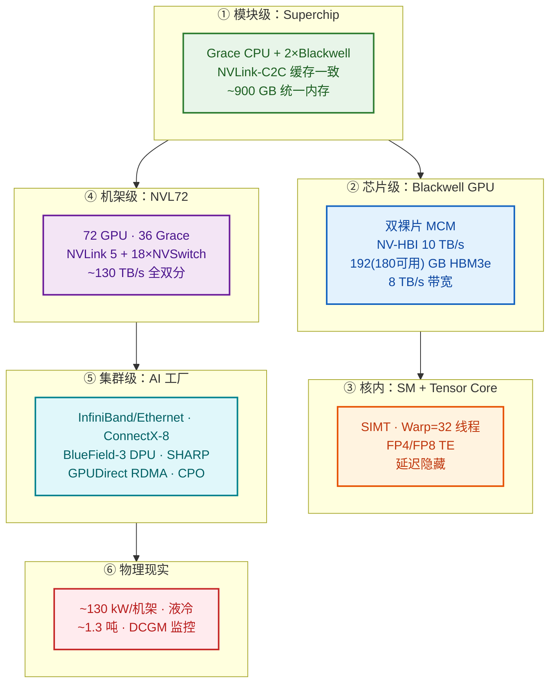

> **一句话主旨**：硬件的每一层——芯片、封装、互连、机架、网络、液冷——都围绕"喂饱 GPU、降低通信、压榨每瓦"协同设计；性能工程师的战场就是把这台 exaFLOPS 怪兽的 goodput 尽量推满。

---

## 1. 超级芯片：CPU + GPU 合二为一

**是什么。** 传统系统里 CPU 和 GPU 各有独立内存池，靠 PCIe（Gen5 x16 ≈ 64 GB/s/方向）来回复制数据。NVIDIA 把这堵墙拆掉了——用 **NVLink-C2C（chip-to-chip）** 把一颗 ARM Grace CPU 和两颗 Blackwell GPU 封在同一模块里，这就是 **GB200 Grace Blackwell Superchip**。

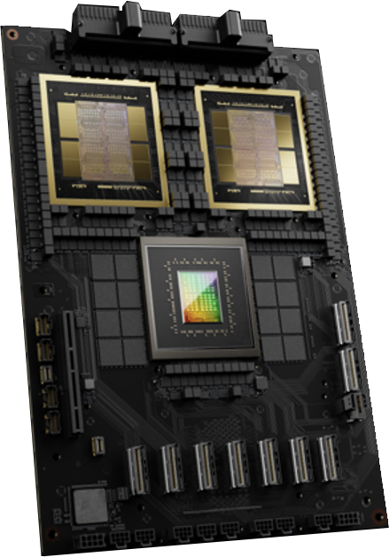

> **图 2-1 解读**：Grace CPU 在中间，两颗 Blackwell GPU 在两边，三者共享统一内存空间。关键不在"放一起"，而在那条**高速、缓存一致**的链路。

**关键数字与对比：**

| 互连 | 带宽 | 一致性 | 用途 |
|---|---|---|---|
| PCIe Gen5 x16 (B200) | ~64 GB/s/方向 | 无 | 传统 CPU↔GPU |
| PCIe Gen6 x16 (B300) | ~128 GB/s/方向 | 无 | 下一代传统路径 |
| **NVLink-C2C** | **~900 GB/s**（~450/方向） | **缓存一致** | Superchip 内 CPU↔GPU |

> **数量级感**：NVLink-C2C 比 PCIe Gen5 快**一个数量级**。

**统一内存（EGM, Extended GPU Memory）的意义与陷阱。**

- **好处**：GPU 可以直接读写 CPU 的 LPDDR5X，程序员面对一个统一虚拟地址空间，不用显式 cudaMemcpy；500 GB 的模型塞不进单卡 180 GB HBM？直接用 Grace 的 480 GB LPDDR5X 补上，**不需要跨 GPU 切分**。
- **陷阱**：LPDDR5X 带宽 ~500 GB/s，比 HBM3e 的 8 TB/s **慢一个数量级**且延迟更高。访问 CPU 内存不是"白给的显存"——它是大但慢的溢出层，要用 `cudaMemPrefetchAsync` / `cudaMemAdvise` **显式预取**，避免缺页停顿。

**GB200 Superchip 内存账面：**

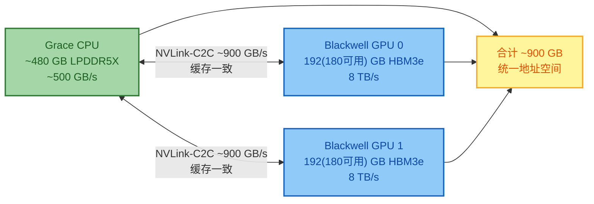

> **心智模型**：把 HBM 当作"L1"（超快小）、LPDDR5X 当作"L2"（大但慢）。聪明的运行时把热数据留在 HBM，冷/溢出数据放 LPDDR5X。

---

## 2. Grace CPU：不抢戏的"喂数据官"

**是什么。** Grace 是 NVIDIA 定制的 **ARM Neoverse V2** CPU，72 核，>100 MB L3，LPDDR5X 带宽 ~500 GB/s。它的定位非常清晰——**不当主角，当好配角**：
- 通用任务、数据预处理（分词、增强）、从存储流式加载数据；
- 通过 NVLink-C2C 高效喂 GPU；
- 承担 GPU 弱项（随机访问、控制密集代码）。

**关键启示**：CPU 启动 GPU kernel 的命令走 NVLink-C2C 而**不**走 PCIe，启动延迟大幅降低——CPU 与 GPU 像"本地函数调用"而非"远端 RPC"。这在小 kernel、频繁启动的场景里是决定性的。

---

## 3. Blackwell "双裸片" GPU：MCM 为什么香

**是什么。** B200 不是一颗单芯片，而是 **MCM（多芯片模块）**——两颗 GPU 裸片用 **NV-HBI（High-Bandwidth Interface，10 TB/s 裸片间互连）** 封装在一起，对外表现为"一颗 GPU"。

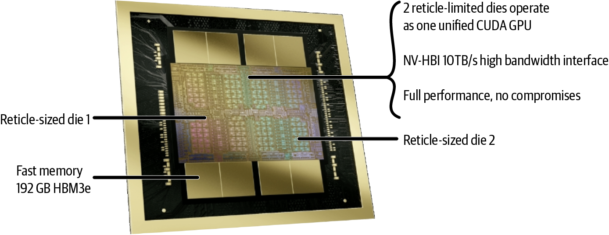

> **图 2-2 解读**：中间的裸片到裸片链路（NV-HBI）是关键——它让两颗裸片在软件看来是一颗 GPU。

**为什么要 MCM？** 硅片大小受良率与光刻限制，单颗大裸片成本指数上升。把一颗"超大 GPU"拆成两颗，再用超快片间链路粘合——**晶体管预算翻倍，良率可控**。

**B200 规格（vs H100）：**

| 项 | Hopper H100 | Blackwell B200 | 倍率 |
|---|---|---|---|
| 晶体管 | ~800 亿 | ~2080 亿（每裸片 1040 亿） | ~2.6× |
| 显存 | 80 GB HBM3 | 192（180 可用） GB HBM3e | ~2.4× |
| 显存带宽 | ~3.35 TB/s | ~8 TB/s | ~2.4× |
| L2 缓存 | 50 MB | 126 MB（每裸片 63 MB） | ~2.5× |

**HBM 堆叠细节（值得记）：**
- 8-Hi 堆栈 = 垂直堆叠 8 个 DRAM 裸片 × 3 GB/裸片 = **24 GB/堆栈**
- B200 共 **8 个堆栈**（每裸片 4 个）→ 8 × 24 = **192 GB**
- 其中 **180 GB 可用**（12 GB 被 ECC / 固件 / 制造裕量吃掉）——做容量规划时务必用 180 而非 192。

**对程序员意味着什么？** 两个裸片对软件透明（NVIDIA 驱动负责负载均衡与一致性），你把它当一颗 GPU 用即可。但**性能工程师**要知道：跨裸片访问比裸片内访问代价高；某些 kernel 布局 / 通信模式如果频繁跨裸片，会"掉速"。

---

## 4. Tensor Core + Transformer Engine：低精度是免费午餐

**核心观察**：AI（尤其 transformer）对数值误差容忍度高 → 用更少 bit 表示数 → 同时做更多运算 + 省内存。

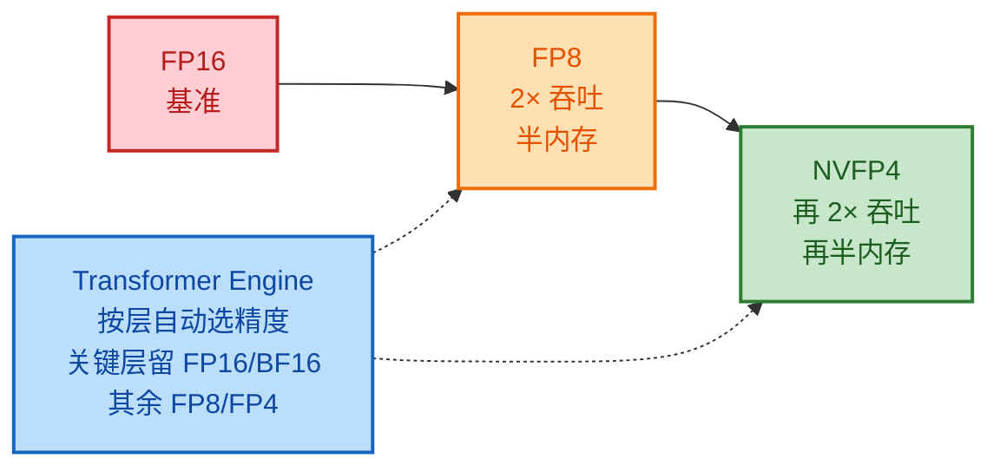

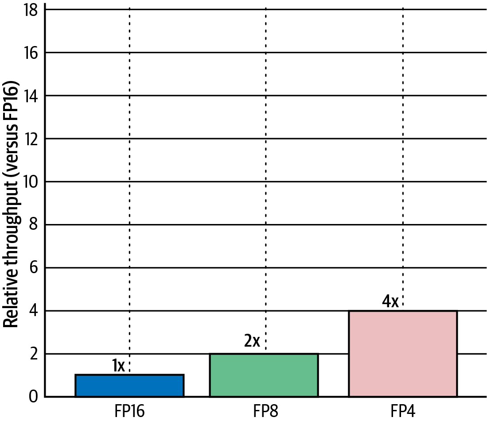

> **图 2-3 解读**：FP8 相对 FP16 翻倍，FP4 再翻倍（理想情形）。实际收益取决于模型对精度的敏感度。

**Transformer Engine (TE) 做什么**：逐层启发式选择最低仍保精度的格式——前层对噪声敏感用 FP16/BF16，后层 / 大嵌入矩阵用 FP8/FP4；带缩放与校准。在 PyTorch 里启用混合精度即可"白拿"加速。

**震撼数字（Hopper → Blackwell，1.8T MoE）：**

| 代 | 每 GPU 吞吐 | 首 token 延迟 |
|---|---|---|
| H100（Hopper） | ~3.4 tok/s | > 5 s |
| GB200 NVL72（Blackwell） | ~150 tok/s | ~50 ms |
| 改进 | **~30×** 实时吞吐 | **100×** 延迟下降 |

> 这不是单卡 FP4 的功劳，而是**算力 + 低精度 + NVLink 喂饱数据**的协同结果——第 1 章"机械同情"的典型落地。

---

## 5. SM、Warp 与 GPU 内存层次

**GPU 的"核"叫 SM（Streaming Multiprocessor）**，一颗 Blackwell 有数百个 SM。理解 SM 就是理解 GPU 的性能模型。

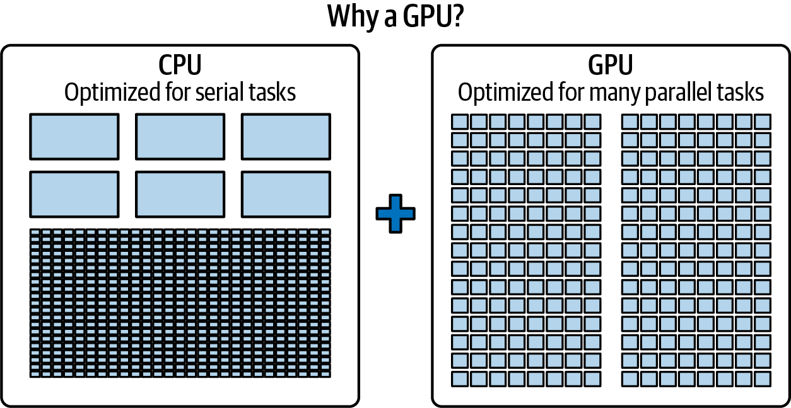

> **图 2-4 解读**：CPU 核少但重（大缓存 + 复杂控制流），GPU SM 多但轻（大量 ALU + 简单控制），走吞吐量路线。

**SM 内部与执行模型：**
- 每个 SM 含 FP32/INT32 算术单元、**Tensor Core**（矩阵乘）、LD/ST 单元、SFU（超越函数）；
- 自有寄存器、共享内存、L1。
- **Warp = 32 线程锁步执行同一条指令（SIMT）**——这是你必须刻进骨头的常量。

**延迟隐藏（latency hiding）**：一个 SM 同时跑几十个 warp（数百线程）；某 warp 等内存时，切到另一个 warp 跑。这是 GPU 用"并行"掩盖"延迟"的核心机制，也是后续章节的高频优化抓手。

**GPU 内存层次（速度从快到慢）：**

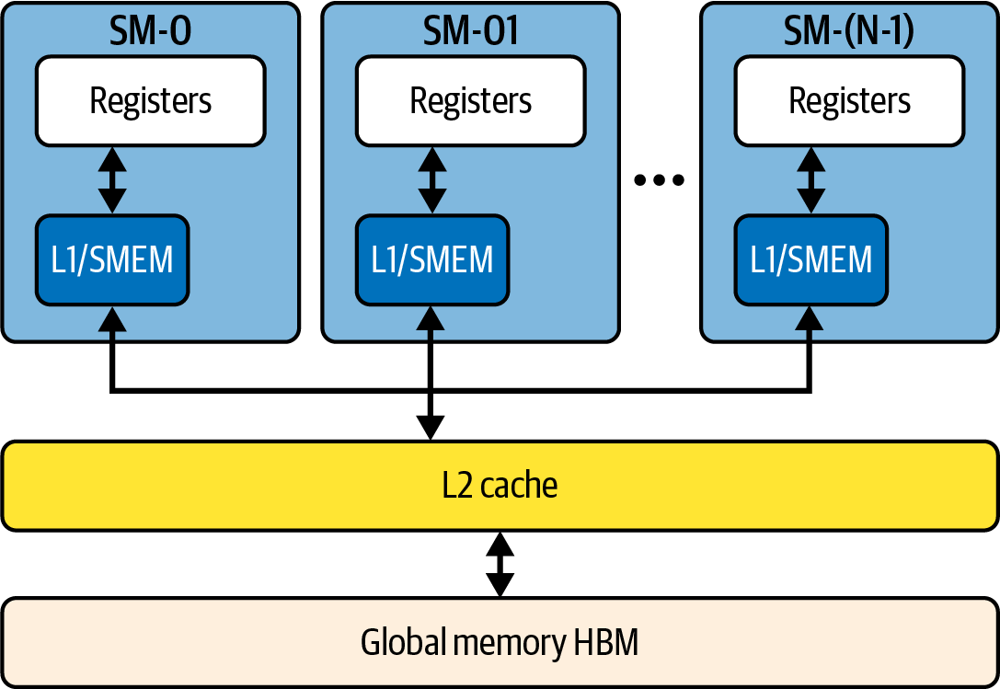

> **图 2-5 解读**：寄存器（per thread）→ 共享内存/L1（per SM）→ L2（全 GPU 共享 126 MB）→ HBM（片外 8 TB/s）。数据越往上（越靠近计算）越快、越小。

**性能工程的金律**：让数据**尽量驻留在层次的高处**。如果每个操作都下到 HBM，GPU 会被片外延迟拖垮。Blackwell 把 L2 从 50 MB 提到 126 MB、带宽从 3.35 提到 8 TB/s，就是为了让"GPU 巨兽吃饱"。

---

## 6. NVL72：72 GPU 像一台机器

**是什么。** 18 个计算节点（tray）+ 9 个 NVSwitch 托盘 = 1 个 NVL72 机架。每个计算节点 = 2 × GB200 Superchip = **4 Blackwell GPU + 2 Grace CPU**。

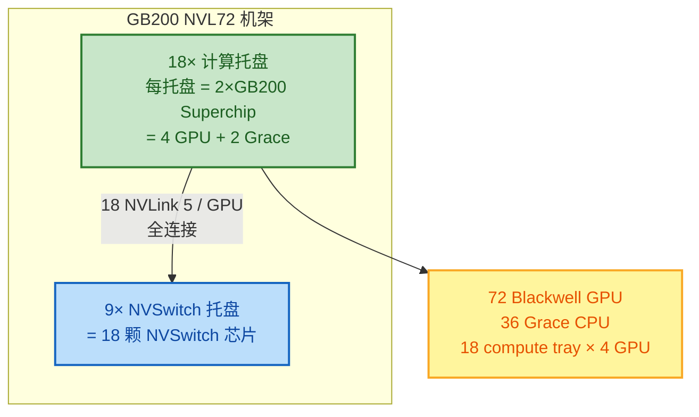

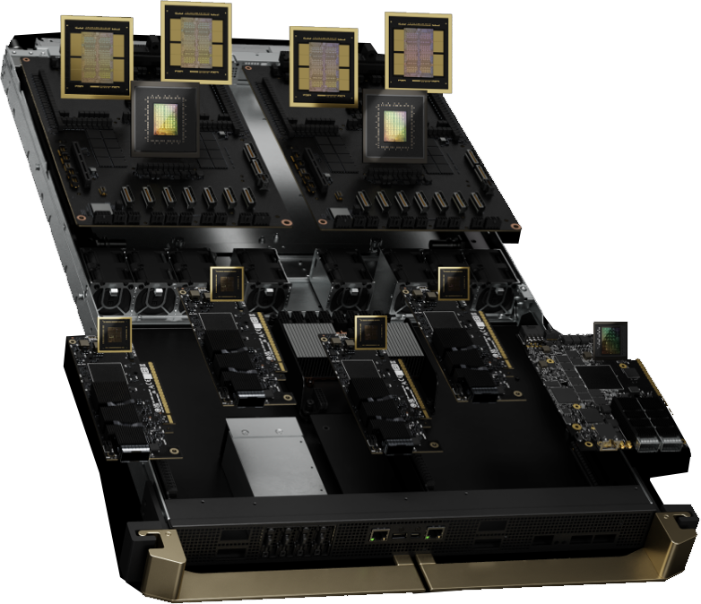

> **图 2-6 解读**：1U 托盘里有 2 个 Superchip（= 4 GPU + 2 Grace）。18 个这样的托盘叠起来就是 NVL72 的算力。

**NVL72 关键参数（账面）：**

| 维度 | 数值 |
|---|---|
| GPU 数 | 72 Blackwell |
| Grace CPU 数 | 36 |
| 每 GPU NVLink 5 端口 | 18 × 100 GB/s = 1.8 TB/s 双向 |
| 机架聚合双分带宽 | ~130 TB/s |
| HBM3e 总量 | ~13.5 TB（~12.96 可用） |
| 含 Grace 总内存 | ~30 TB |
| FP4 理论峰值 | ~1.44 exaFLOPS（2:1 稀疏） |
| 功率 | ~120–130 kW |

> 对比传统 72×H100 集群（9 台 8-GPU 服务器，走 InfiniBand）：NVL72 把集合通信开销从"几十个百分点"压到"几个百分点"。

---

## 7. NVLink / NVSwitch / SHARP：把通信压到个位数微秒

**拓扑是全交叉开关（full crossbar）**：72 GPU × 18 NVSwitch，**每个 GPU 连到每颗 NVSwitch 一条链路** → 任意 GPU 一跳可达任意 GPU（GPU → NVSwitch → GPU）。

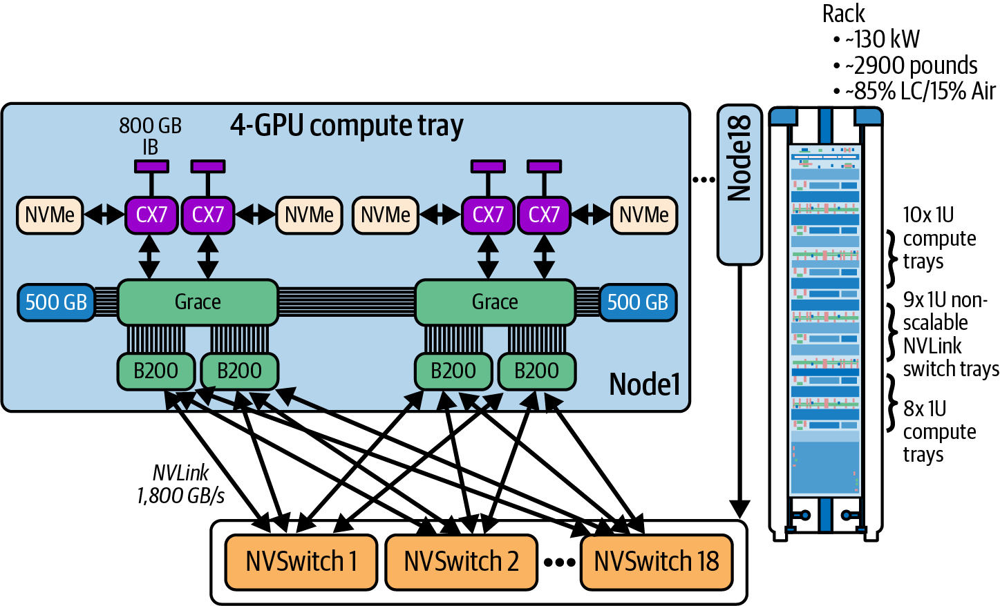

> **图 2-9 解读**：这是一张经典的 Clos/交叉开关示意——72 个 GPU（36 Superchip）连向 18 个 NVSwitch，任何两 GPU 通信都只需经过一颗交换芯片，全双分带宽。

**带宽与延迟对比（必记）：**

| 互连 | 每 GPU 带宽 | 小消息延迟 |
|---|---|---|
| **NVLink 5（机柜内）** | ~1.8 TB/s 双向 | ~1–2 µs |
| InfiniBand（传统跨节点） | 20–80 GB/s（看 NIC 数量/速度） | 5–10+ µs |
| 现代主机 NIC（400–800 Gb/s） | 50–100 GB/s/端口 | — |

> 数量级：NVLink 5 在带宽上比传统 IB **高 20–90 倍**，延迟低数倍。

**一个非常重要的"反直觉"点：GPU 间缓存不全局一致**
- CPU↔GPU（NVLink-C2C 路径）：缓存一致；
- GPU↔GPU（跨 NVLink）：**有全局地址空间但缓存不自动一致**——正确的同步/顺序由 NCCL / NVSHMEM 等软件层保证。
- 把 NVL72 当"一个大 GPU"用，是指**语义**而非"自动一致性"。

**SHARP（网络内归约）：把 all-reduce 搬进交换机。**

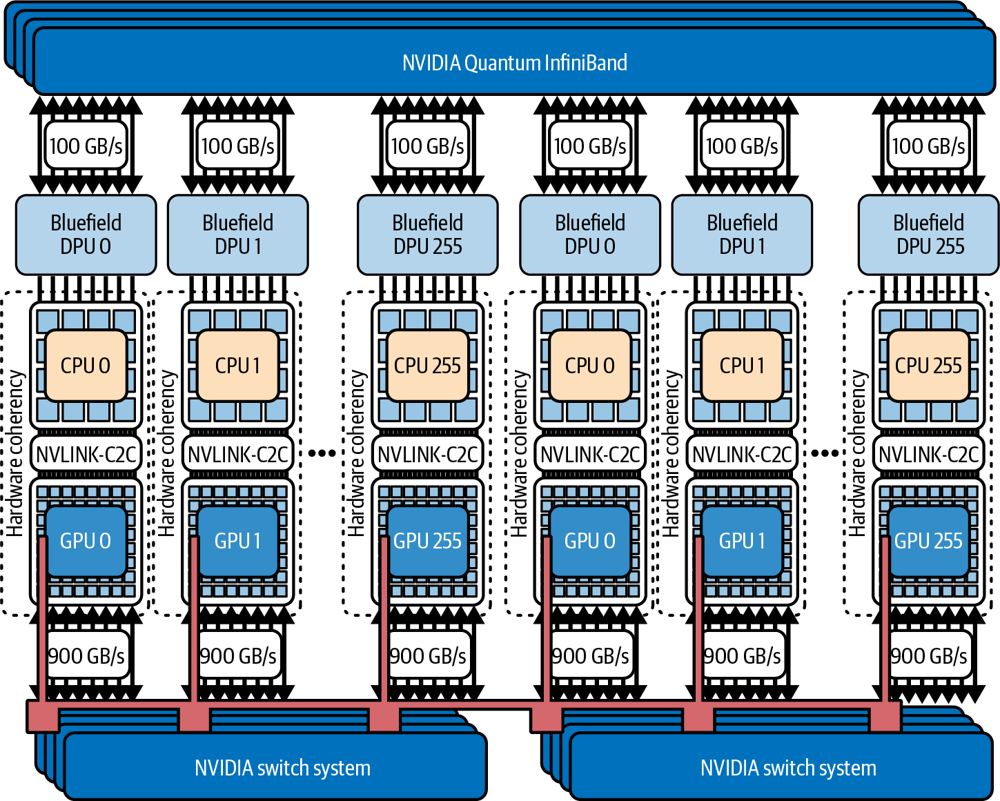

> **图 2-10 解读**：传统 all-reduce 要把数据运回 GPU 做求和再发出去；SHARP 让 NVSwitch 里的专用引擎直接在网络中累加部分结果，GPU 省下来的算力继续训练。
> - 降低集合延迟
> - 减少网内总数据量
> - GPU 数增长仍近线性扩展
> 源自 NVIDIA 2019-2020 收购 Mellanox 的关键技术资产。

**GPUDirect RDMA**：NIC 直接 DMA 到 GPU 显存（经 `nvidia-peermem` 驱动），绕过主机 RAM 暂存、不占 CPU 周期。配合 NVSHMEM 还能做远程原子操作。

---

## 8. 跨机柜、DPU 与 AI 工厂

**机柜内 vs 机柜外是两个世界**：

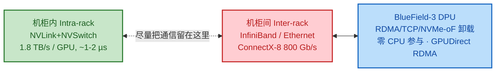

**设计原则**：**把尽量多的通信留在机柜内（intra-rack）**，只有必要时才跨机柜（inter-rack）。

**外部带宽账面（数字很惊人但要会读）：**
- 每节点 4 × ConnectX-8 800 Gb/s NIC = 3.2 Tbit/s/节点
- 单机柜 18 节点 = **57.6 Tbit/s**（对外）
- BlueField-3 DPU 处理线速包、RDMA、NVMe-oF，解放 Grace CPU；
- DPU 还提供安全多租户（隔离网络流量，相当于节点级防火墙/虚拟交换机）。

**多机柜 = AI 工厂**：8 机柜 = 576 GPU 组成一个 NVLink 5 域，再通过 IB/Ethernet 连其它域/外部存储。
**CPO（Co-Packaged Optics，共封装光学）**：把光引擎直接放到交换硅旁边，缩短电路径 → 更高带宽、更低功耗，是把"几百上千机柜"连成 AI 工厂的关键技术。

**交付形态**：NVL72 作为预集成机柜设备（appliance）出货——18 计算托盘 + 9 NVSwitch 托盘 + 液冷 + 电源 + 布线都已预组装，到现场接电、接水冷、接 IB 就能用；随附 Base Command Manager + SLURM/K8s 调度。

---

## 9. 功率、液冷与物理现实

**功率账（必记）：**

| 组成 | 功率 |
|---|---|
| 每计算节点（2×Superchip） | ~6 kW |
| 18 计算节点合计 | ~110 kW |
| NVSwitch + 网交 + 液冷泵 | ~20 kW |
| **NVL72 整机柜** | **~130 kW** |

> 对比前代 AI 机柜 50–60 kW，翻倍有余。**8 个机柜（576 GPU）≈ 1 MW**——一个小型数据中心的整容量。

**为什么必须液冷：**
- 72 个 GPU 每颗 ~1000 W、每 CPU ~500 W，风冷需要"飓风级"气流，既吵又低效；
- 冷板（cold plate）直接贴芯片，水基冷却液循环带走热量，经 CDU（冷却液分配单元）把热量交换到设施冷冻水回路；
- 现代"温水液冷"进水 30°C / 出水 45°C，可直接用蒸发冷却塔散热，省掉制冷机；
- 液冷把 GPU 温度压在 50–70°C → **减少热节流、降低漏电功耗、提高可靠性**。

**粗略冷却流量**：10–12°C 温升下，散 130 kW 需 150–200 L/min 流量。

**物理"脚注"**：
- 整柜装满≈ 3000 磅（~1.3–1.4 吨），架空地板要做承重加固；
- 毫秒级功率瞬变（72 GPU 同时从空闲拉到满载）需电容/错峰升压防抖；
- 双路独立供电（每路都能带满整柜）防单点故障——否则一断电就是几个月训练打水漂。

> **这就是"协同设计"延伸到数据中心的样子**：电气、冷却、承重都是性能工程的一部分。

---

## 10. 监控、共享调度与 ROI

**监控工具栈：**
- **DCGM（Data Center GPU Manager）**：GPU 利用率、显存、温度、NVLink 吞吐等每 GPU 指标；
- BlueField DPU / NIC 自有统计；
- 功率监控：每节点/每 GPU 功耗，必要时**功率封顶（power cap）**省点电——小作业用不上全性能，降频换每瓦性能（perf/Watt），长期跑省数千美元。

**共享与调度：**
- SLURM / Kubernetes + NVIDIA 插件在同一机架内切分 GPU（如 8/16/48 GPU 给不同用户）；
- **MIG（Multi-Instance GPU）**：硬件级把一颗 Blackwell 切成最多 **7 个隔离实例**（各自独占 SM + 显存），推理场景里一卡跑多模型；
- 计费模式（chargeback，按 GPU-小时向内部团队收费）让资源不被浪费。

**ROI 的直觉（粗略模型）：**
- 100 × H100 跑某工作负载，可能用 50 × Blackwell 就够（每卡 ~2×+ 快，配合 FP8/FP4 更多）；
- 100×H100 拉 70 kW，50×B200 拉 50 kW → 每年省数万美元电费；
- 机器数减半 → 服务器、CPU、RAM、网络、维护都省；
- 1–2 年回本，且软件架构因"不必跨多卡切模型"而简化。

> 第 1 章的 goodput 在这里有了财务意义：一台百万美元、月耗数万美元电费的设备，闲置就是巨额浪费。

---

## 11. 路线图：Blackwell → Vera Rubin → Feynman

NVIDIA 节奏：**每代翻倍点什么**。

| 代（年份） | CPU / GPU | GPU 显存 | 关键变化 |
|---|---|---|---|
| GB200 NVL72（2024，当下） | Grace + 2×B200 | 180 GB HBM3e / GPU | 双裸片 MCM、NVLink 5 |
| **GB300 NVL72 Ultra**（B200 的"加量版"） | Grace + 2×B300 | **288 GB** / GPU，推理吞吐高 45–50% | 更多 SM、更高时钟，同架构演进 |
| **Vera Rubin VR200**（2026） | Vera（3nm, LPDDR6 ~1 TB/s）+ 2×Rubin | 288 GB HBM，~13–14 TB/s；可能加 256 GB LPDDR 作"GPU 二级内存"→ 单模块 ~550 GB 统一内存 | NVLink 6（带宽翻倍），每机架性能 ~5×，功率也 ~5×（近 600 kW） |
| **Rubin Ultra R300 / NVL144**（2027） | 推测 **四裸片** GPU | 单 GPU 模块 1 TB HBM，每机柜 3–4 exaFLOPS / 165 TB HBM | NVL144（144 裸片/机柜）、NVL576 |
| **Feynman**（2028） | 2 nm、HBM5、可能 8 裸片、CPO 片上光链路 | — | 推推理时代优化（推理需求比非推理模型大成百上千倍） |

> **性能工程师的 takeaway**：每一代都会解锁新的精度/内存/互连，你的软件必须不断适配。今天不可行的模型，几年后是常规。

---

## 12. 分层自测

> 先独立作答，再点开 `
` 对照。答案强调**讲清机制与数字**。

### A · 概念与机制

<b>Q1.</b> NVLink-C2C 相对 PCIe 的本质优势是什么？缓存一致对程序员意味着什么？

- **带宽**：NVLink-C2C ~900 GB/s（双向 ~450/方向），比 PCIe Gen5 x16（~64 GB/s/方向）快约一个数量级。
- **缓存一致**：CPU/GPU 看到同一份数据的同一份值，统一虚拟地址空间；GPU 可直接访问 Grace 的 LPDDR5X（EGM），省去显式 cudaMemcpy。
- **注意**：LPDDR5X 带宽 ~500 GB/s，比 HBM3e（8 TB/s）慢一个数量级——统一内存*简化正确性*但不*取消性能差异*，仍需显式预取/数据放置。

<b>Q2.</b> 为什么 Blackwell 要用双裸片 MCM？软件能感知到两颗裸片吗？

- 原因：单片大 GPU 受光刻/良率限制；MCM 让晶体管预算翻倍（2080 亿）、显存翻倍（192 GB），同时良率/成本可控；两颗裸片以 10 TB/s 的 NV-HBI 互连粘合。
- 软件视角：对外表现为**一颗 GPU**，驱动负责负载均衡与一致性；但性能工程师需注意跨裸片访问代价更高。

<b>Q3.</b> 解释 SIMT、Warp、延迟隐藏三者关系。

- GPU 以 **Warp=32 线程**为调度单位，锁步执行同一条指令（SIMT）。
- 一个 SM 并发跑数十个 warp；某 warp 等内存时，SM 切到另一个就绪 warp 继续算——这就是**延迟隐藏**。
- 并发 warp 足够多才能把内存/算术延迟"藏"住，这是 GPU 吞吐模型的核心。

<b>Q4.</b> 从快到慢列出 GPU 内存层次。Blackwell 相对 Hopper 在哪些层"加宽加厚"了？

- 寄存器 → 共享内存/L1（per SM）→ L2（全 GPU 共享）→ HBM（片外）。
- Blackwell：HBM 80 GB→192（180 可用）GB；带宽 3.35→8 TB/s；L2 50→126 MB。
- 原则：数据越往高层（近计算）越快越小，优化内核时要最大化高层命中率。

<b>Q5.</b> Transformer Engine 怎么"白拿"加速？为什么 FP4/FP8 没在精度上崩溃？

- TE 逐层启发式选最低仍保精度的格式：噪声敏感的前层用 FP16/BF16，后层/大嵌入用 FP8/FP4，配合缩放/校准；
- Transformer 对低精度天然容忍，关键是只在"可以低"的地方低；
- 吞吐：FP8 ≈ 2× FP16，FP4 ≈ 再 2×，内存也同比例省。

### B · 拓扑与网络

<b>Q6.</b> NVL72 里 72 个 GPU 怎么做到任意两 GPU"一跳可达"？双分带宽多少？

- 每 GPU 有 **18 条 NVLink 5**（每条 100 GB/s，总 1.8 TB/s 双向），分别连到 **18 颗 NVSwitch**（9 个托盘 × 每盘 2 颗）。
- 任意 GPU→某 NVSwitch→目标 GPU，**单跳**全双分带宽，整柜聚合 **~130 TB/s**。

<b>Q7.</b> GPU↔GPU 通过 NVLink 是缓存一致的吗？跨节点走什么？GPUDirect RDMA 的价值？

- GPU↔GPU 在 NVLink 上有全局地址空间但**缓存不自动一致**，需要 NCCL/NVSHMEM 显式同步；CPU↔GPU 的 NVLink-C2C 路径才是缓存一致。
- 跨机柜走 InfiniBand（Quantum-X800）或 Ethernet（Spectrum-X800），由 ConnectX-8 NIC + BlueField-3 DPU 承载。
- **GPUDirect RDMA** 让 NIC 直接 DMA 到 GPU 显存，不经主机 RAM 暂存、不占 CPU；NVSHMEM 在其之上提供远程原子/单边操作。

<b>Q8.</b> SHARP 解决什么问题？为什么它"源自 Mellanox 收购"值得记？

- SHARP 在 NVSwitch ASIC 内嵌入归约引擎，**在网络内直接累加梯度/参数部分结果**，不必把数据运回 GPU 再算：降延迟、减网内流量、随 GPU 数近线性扩展。
- 是 NVIDIA 2019–2020 收购 Mellanox 后获得的核心网络内计算能力，对通信受限训练的扩展效率影响极大。

### C · 计算与工程细节

<b>Q9.</b> 为什么 B200 标 192 GB 却要按 180 GB 规划？192 GB 怎么由 HBM 堆栈数得出？

- 12 GB 被 ECC、固件、制造裕量保留 → 180 GB 才是可用。
- 构成：每裸片 4 堆栈，共 8 堆栈；每堆栈 24 GB（8-Hi × 3 GB/裸片）；8 × 24 = 192 GB。

<b>Q10.</b> 1.8 万亿参数 MoE 在 H100 vs NVL72 的数字差多少？背后是哪几重因素叠加？

- H100：~3.4 tok/s/GPU、首 token > 5 s；NVL72：~150 tok/s/GPU、~50 ms → 约 **30× 吞吐 / 100× 延迟**。
- 叠加因素：Blackwell 更高原始 FLOPS + FP4/TE 低精度 + NVL72 消除 GPU 间通信瓶颈。

<b>Q11.</b> 整柜 130 kW 功率怎么构成？为什么必须液冷？

- 18 节点 × 6 kW = 110 kW；NVSwitch/交换/液冷泵 ≈ 20 kW；合计 ~130 kW。
- 单 GPU ~1000 W、CPU ~500 W，72 GPU 风冷需飓风级气流不可行；冷板液冷把温度压在 50–70°C，减热节流、降漏电、省能耗；温水液冷可省制冷机。

<b>Q12.</b> 解释机柜内（intra-rack）vs 机柜间（inter-rack）为什么要"本地化通信"？DPU 加进来干嘛？

- 机柜内 NVLink 5 ≈ 1.8 TB/s、1–2 µs；机柜外 IB/Ethernet 是 50–100 GB/s、5–10 µs——差一个数量级以上，把通信留在柜内可显著提扩展效率。
- BlueField-3 DPU 卸载 RDMA/TCP/NVMe-oF、做 GPUDirect RDMA、提供多租户安全隔离，解放 Grace CPU 去做数据预处理。

### D · 开放思考题

<b>Q13.</b> 第 1 章讲"机械同情 / 协同设计"，第 2 章硬件里你能找出至少 3 处体现协同设计的例子吗？

开放题，答对方向即可。参考：
- Superchip 把 CPU+GPU 封一起 + NVLink-C2C 缓存一致 + EGM（硬件↔编程模型）；
- SHARP 把归约搬进交换机（算法↔网络硬件）；
- TE 配合 Tensor Core / FP4（算法↔计算单元）；
- 液冷/配电与机柜协同设计，把 130 kW 塞进一柜（芯片↔数据中心）；
- MCM + NV-HBI（封装工艺↔GPU 架构）。

<b>Q14.</b> 如果你要给一台 NVL72 做容量规划放 500 GB 的大模型，你会怎么放？为什么？

参考思路：单 GB200 Superchip 有 ~180 GB HBM + ~480 GB LPDDR5X ≈ 900 GB 统一内存，500 GB 模型可以塞在 *单个 Superchip* 内而不跨 GPU 切分——热层留 HBM、冷层/嵌入表溢出到 LPDDR5X，用预取+流水线化掩盖 LPDDR 带宽差；跨 GPU 切分会引入 NVLink 通信，能不切就不切。

---

## 13. 一页速查

**Superchip 核心账**

| 项 | 值 |
|---|---|
| GB200 = | 1 Grace + 2 Blackwell（B200） |
| NVLink-C2C | ~900 GB/s，缓存一致 |
| Grace LPDDR5X | ~480 GB，~500 GB/s |
| 每 B200 HBM3e | 192（**180 可用**）GB，8 TB/s |
| Superchip 总内存 | ~900 GB 统一地址空间 |

**Blackwell GPU 架构**

| 项 | B200 | vs H100 |
|---|---|---|
| 晶体管 | ~2080 亿（双裸片） | ~2.6× |
| HBM3e | 8 堆栈 × 24 GB = 192（180 可用）GB | ~2.4× |
| 带宽 | 8 TB/s | ~2.4× |
| L2 | 126 MB | ~2.5× |
| 裸片互连 | NV-HBI 10 TB/s | MCM 新增 |

**NVL72 机架**
- 18 计算托盘 ×（2×Superchip = 4 GPU + 2 Grace）= **72 GPU + 36 Grace**
- 18 颗 NVSwitch（9 托盘 × 2），**全交叉全双分**，整柜 **~130 TB/s**，每 GPU **1.8 TB/s 双向**，延迟 **1–2 µs**
- ~13.5 TB HBM3e，含 Grace ~30 TB；FP4 ~1.44 exaFLOPS（2:1 稀疏）；**~130 kW，液冷，~1.3 吨**
- SHARP：网络内归约；GPUDirect RDMA：NIC↔GPU 零拷贝
- 柜外：ConnectX-8 800 Gb/s × 4 = 3.2 Tbit/s/节点，57.6 Tbit/s/柜；BlueField-3 DPU；CPO 为 AI 工厂铺路

**路线图节奏**：GB200(2024) → GB300(288 GB/GPU) → Vera Rubin VR200(2026, NVLink 6, ~5×) → R300/NVL144(2027, 四裸片, 1 TB HBM/GPU) → Feynman(2028, 2 nm, HBM5, 推推理优化)

**术语快查**：Superchip · NVLink-C2C · EGM · MCM/NV-HBI · HBM3e 8-Hi 堆栈 · Tensor Core · TE · NVFP4 · SM · Warp=32 · SIMT · 延迟隐藏 · NVSwitch 全交叉 · SHARP · GPUDirect RDMA · NVSHMEM · BlueField-3 DPU · NVMe-oF · CPO · DCGM · MIG（单卡最多 7 实例）· 双路供电 · CDU · 温水液冷

**自查清单**
- [ ] 能在白板画出 GB200 Superchip 构成、带宽、内存账
- [ ] 能讲清 MCM 为什么香、180 vs 192 GB 区别
- [ ] 能按快慢顺序背出 GPU 内存层次
- [ ] 能讲清 NVL72 的全交叉拓扑与 SHARP 作用
- [ ] 能区分 NVLink-C2C（CPU↔GPU 一致）与 GPU↔GPU NVLink（地址空间一致但缓存不一致）
- [ ] 能复述 1.8T MoE 的 H100→NVL72 数字及背后三重因素
- [ ] 能解释为什么必须液冷、DPU 干了什么
