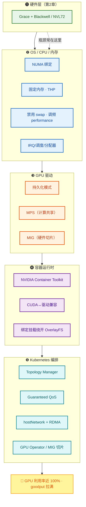
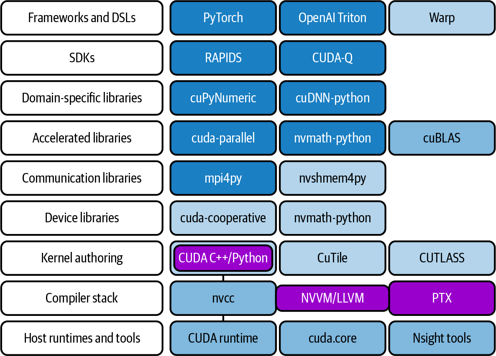
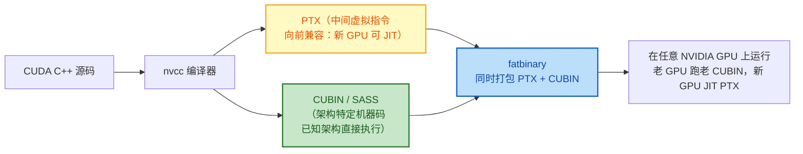
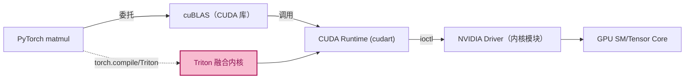
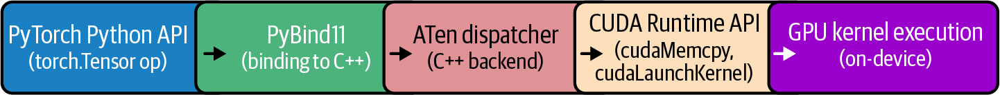
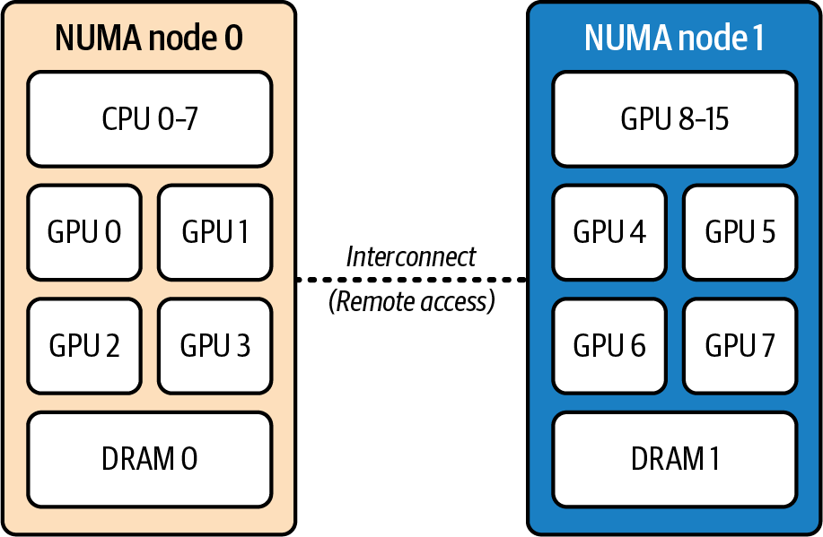
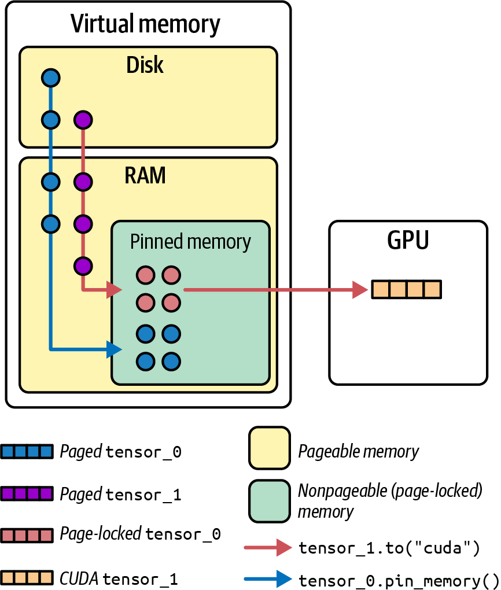
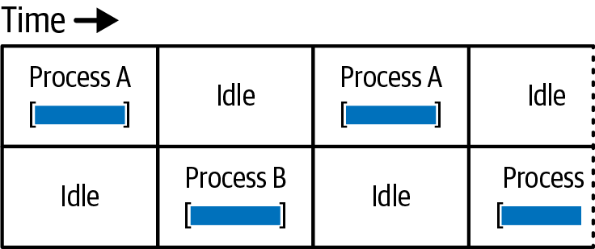
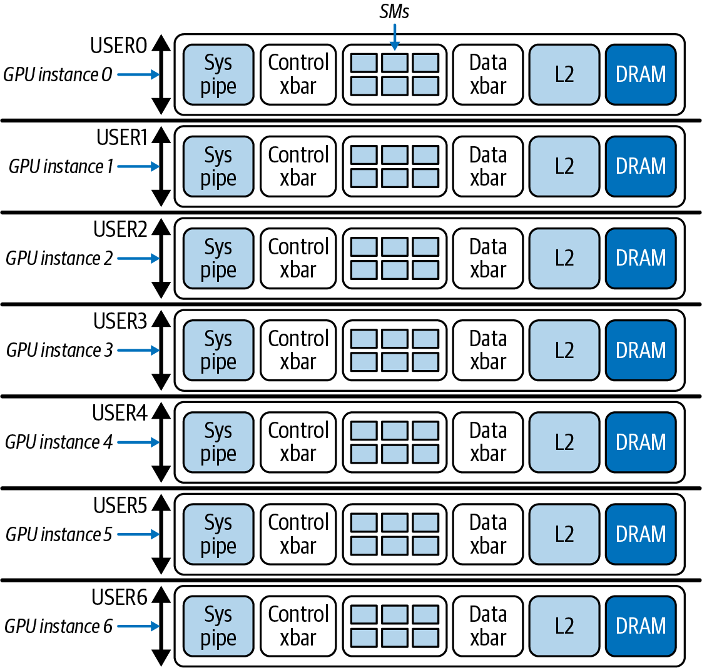

# 第 3 章 复习与自测 · GPU 环境的 OS、Docker 与 Kubernetes 调优

> **本笔记的用法**
> 第一部分「深度精读」按"是什么 → 为什么 → 怎么做 → 启示"四层重构全章，配书中原图；第二部分「自测」用分层题目检验你能否*讲清机制*而非*背下结论*。
> 建议流程：先盖住答案做自测 → 再读精读补漏 → 最后用文末「一页速查」做长期记忆锚点。

---

## 目录

- [0. 全章思想地图](#0-全章思想地图)
- [1. 软件栈全景：从 PyTorch 到裸片有多远](#1-软件栈全景从-pytorch-到裸片有多远)
- [2. CPU / OS 调优：把"喂数据"这条路打通](#2-cpu--os-调优把喂数据这条路打通)
- [3. GPU 驱动与运行时旋钮：Persistence / MPS / MIG](#3-gpu-驱动与运行时旋钮persistence--mps--mig)
- [4. 容器运行时：Docker 里跑出裸机性能](#4-容器运行时docker-里跑出裸机性能)
- [5. Kubernetes 编排：拓扑感知、资源保证、抖动抑制](#5-kubernetes-编排拓扑感知资源保证抖动抑制)
- [6. 分层自测](#6-分层自测)
- [7. 一页速查](#7-一页速查)

---

## 0. 全章思想地图

第 1、2 章给了你 exaFLOPS 怪兽；第 3 章告诉你**怪兽喂不饱就是一堆昂贵的废铁**。叙事是"从下往上、一层层把可能的摩擦点抹平"：OS / CPU / 内存 → 驱动级共享 → 容器 → K8s 编排。



> **一句话主旨**：GPU 利用率低，多半不是 GPU 慢，而是 CPU/OS/驱动/容器/编排层有摩擦；本章给你一套"从内核到 K8s"的调优清单，把 GPU 饥饿、抖动、浪费全消灭掉。

---

## 1. 软件栈全景：从 PyTorch 到裸片有多远

你在 Python 里写 `tensor @ tensor`，底下其实是一整棵栈。这是很多性能问题的藏身之地。



> **图 3-1 解读**：从"PyTorch/Triton/Warp"（顶层 DSL）一直到"C 运行时、Nsight 工具"（底层），任何一层版本错配、库没选对、编译器没开优化，都会让上层"以为很快"的代码变慢。
> **关键两层要分清：**
> - **CUDA Runtime（容器里带）**：`libcudart.so` 等，应用直接链接；
> - **NVIDIA Driver（主机上装）**：`libcuda.so` 等，内核模块，真正操作硬件。
> 二者由 **NVIDIA Container Toolkit** 在容器启动时把主机驱动*注入*容器，所以容器里不需要装驱动——但**主机驱动必须 ≥ 容器 CUDA 所需的最低版本**。

**CUDA 跨代兼容的机制（fatbinary + PTX + CUBIN）：**



| 名词 | 是什么 | 作用 |
|---|---|---|
| **PTX** | 虚拟 ISA 中间表示 | 面向未来：新 GPU 驱动可 JIT 成新 SASS，保证*向前兼容* |
| **CUBIN / SASS** | 具体架构的流汇编机器码 | 在已知 GPU 上直接执行，免 JIT 开销 |
| **fatbinary** | 把 PTX + 多个 CUBIN 打包 | 一次编译，覆盖"已发布 + 未来"GPU |
| **Compute Capability (CC)** | GPU 架构版本号（如 Blackwell sm_100/120） | 决定能跑哪些 SASS |

> **工程要点**：要兼容未来 GPU，发布的二进制**必须包含 PTX**；只发 CUBIN 到下代 GPU 就跑不起来。

**一条 PyTorch 调用的下沉路径**（`torch.matmul`）：





> 图 3-3 展示了 Python 调用如何层层翻译到 CUDA Runtime 与库。性能工程师的工作就是确保*这条链没有任何一环让 GPU 等*。

---

## 2. CPU / OS 调优：把"喂数据"这条路打通

**核心矛盾**：训练循环里 CPU 负责"准备下一批数据（加载/分词/增强）+ 派发 GPU kernel"，只要 CPU 慢一拍，后面所有 GPU 全闲。**GPU 利用率低，70% 是 CPU/OS 问题。**

### 2.1 NUMA 亲和性与 CPU 绑定

**是什么。** 现代服务器 CPU 分多个 NUMA 节点；每个节点内 CPU/内存/GPU/NIC"近"，跨节点延迟可**翻倍**（实测本地 ~80 ns vs 远程 ~139 ns，+75%）。

**正确姿势**：把训练进程及其内存**绑到它服务的 GPU 所在 NUMA 节点**。



> **图 3-4 解读**：GPU 0–3 连 NUMA 节点 0，GPU 4–7 连节点 1。给 GPU 4 喂数据的进程必须跑在节点 1 的核上，内存也从节点 1 分配。

**最小可用命令（记住这条就够）：**

```bash
numactl --cpunodebind=1 --membind=1 python train.py --gpu 4
```

| 参数 | 作用 |
|---|---|
| `--cpunodebind=N` | 把进程/线程的 CPU 限制在节点 N |
| `--membind=N` | 强制内存只从节点 N 分配 |
| `taskset -c <cpulist>` | 绑到具体核心 ID（更细粒度） |

> **Grace Blackwell 上的注意点**：虽然 CPU↔GPU 通过 NVLink-C2C 缓存一致，Linux 仍把 LPDDR5X 当 CPU NUMA 内存、HBM 当设备内存。**继续绑核对局部性仍有益**。

**常见坑：**
- 默认 Linux NUMA balancing 不够，进程会被迁移到远端核；
- `numactl` 策略在 `fork` 后继承，但在 `spawn` / `exec` 后**不继承**——框架用多进程 DataLoader 时必须在每个 worker 里重新声明；
- 实战里仅做 NUMA 绑定就能拿到 **5–10% 吞吐提升**并降低抖动。

**PyTorch DataLoader 三行关键配置（和 NUMA 绑定搭配用）：**

```python
DataLoader(...,
    pin_memory=True,           # 用固定内存（见 2.2）
    num_workers=N,
    persistent_workers=True,   # 避免每 epoch 重新 fork 丢失亲和性
    prefetch_factor=2,
)
batch = batch.to("cuda", non_blocking=True)
```

### 2.2 固定内存（Pinned / Page-locked Memory）

**是什么。** 默认主机内存是"可分页"的，OS 可把它换出到磁盘；GPU/NIC 做 DMA 时无法直接访问（必须先拷贝到临时固定页，再 DMA）。**固定内存**告诉 OS"这块页别动"，于是 GPU/NIC 可直接 DMA，H2D 拷贝快 **2–3×**。



> **图 3-5 解读**：固定内存（pinned / page-locked）不参与 swap，是 GPUDirect RDMA / GPUDirect Storage 的物理基础。

**落地：**
- PyTorch：`pin_memory=True` 即可，常见 **10–20%** 提升；
- CUDA：`cudaHostAlloc()` / `cudaMallocHost()`；
- 系统：`ulimit -l unlimited`（容器里 `--ulimit memlock=-1`），否则固定大块会失败；
- 带宽自测：`bandwidthTest --memory=pinned` vs `--memory=pageable`。

### 2.3 透明大页（THP）

Linux 默认 4 KB 页，几十/上百 GB 数据集和模型参数会产生海量页表项 → TLB miss / page fault 多。**大页** = 2 MB（甚至 1 GB）页：

| 场景 | THP 设置 | 原因 |
|---|---|---|
| **训练（吞吐优先）** | `always`（默认 2 MB 即可） | 减页错/TLB 压力，+3–5% |
| **推理（延迟优先）** | `madvise` 或 `never` | THP 后台压缩（compaction）造成不可预测停顿，对延迟是灾难 |
| 大块预分配固定缓冲区 | `vm.nr_hugepages` + `hugetlbfs` | 确定性最好 |

### 2.4 其他 OS 旋钮（清单式记忆）

| 类别 | 配置 | 为什么 |
|---|---|---|
| 虚拟内存 | `vm.swappiness=0`；最好 `swapoff -a` | 主机内存一旦换到磁盘，GPU 取数据雪崩式变慢 |
| 固定内存上限 | `ulimit -l unlimited` | 允许 pin 大块 |
| 调度 | 关键线程绑核 + `isolcpus`/`nohz_full`/cset 隔离出"专属核"；irqbalance 禁用或定制 | 数据管道线程不被 OS 打断/迁走 |
| 中断亲和性 | `/proc/irq/*/smp_affinity` 把 GPU/NIC 中断绑到同 NUMA 节点的核 | 避免跨节点中断触发缓存一致性流量 |
| CPU 频率 | `cpupower frequency-set -g performance`；BIOS 关深度 C-state | CPU 省电醒来要几 µs，累积成 GPU 气泡 |
| 脏页回写 | 调 `vm.dirty_ratio` / `dirty_background_ratio` | 平滑多 GB checkpoint 写盘，避免停顿尖刺；延迟敏感场景用 `O_DIRECT` + `posix_fadvise(DONTNEED)` 绕页缓存 |
| 分配器 | `jemalloc` 或 `tcmalloc`，配 `MALLOC_CONF` / `TCMALLOC_*` | 减分配锁争用和碎片，消除数据准备抖动 |
| 超线程 SMT | 工作负载依赖，有的场景关掉更稳定 | 核独占性更强 |

**CPU↔GPU 耦合的哲学**：GPU 是主功耗者，CPU 多吃一点电换"GPU 永远不饿"是划算的。

---

## 3. GPU 驱动与运行时旋钮：Persistence / MPS / MIG

驱动层面有三个最常被问到的功能，它们解决不同问题，**不要混淆**。

### 3.1 持久化模式（Persistence Mode）

- **默认**：无作业时驱动卸载 GPU 上下文省电；下一个作业上来要重新初始化（秒级延迟）。
- **开启**：`nvidia-persistenced`（systemd 开机自启，K8s 上用 GPU Operator 配置）——驱动常驻、硬件就绪，**零启动延迟**。
- **取舍**：空闲多耗一点电，但交互式/低负载推理/频繁启停场景必须开。

### 3.2 MPS（Multi-Process Service）vs MIG

这两者是最容易混的。一张对比表讲清：

| 维度 | MPS | MIG |
|---|---|---|
| 抽象层级 | 软件调度层（合并上下文） | **硬件级分区** |
| 共享内容 | SM/计算**时间+空间**重叠 | 计算、内存、L2、Copy Engine **硬隔离** |
| 内存 | 共享全部 GPU 显存，**不隔离** | 每个切片独占固定显存 |
| 故障域 | 一个进程 OOM 全灭 | 一个实例崩溃不影响别的 |
| 跨 GPU P2P / NVLink | 支持 | **禁用**（含 NVLink / PCIe P2P / CUDA IPC）|
| 适用场景 | 小推理作业**重叠**计算填 SM 空隙、单卡多进程高吞吐 | **强多租户隔离**、不同用户/不同 SLA |
| 资源粒度 | `CUDA_MPS_ACTIVE_THREAD_PERCENTAGE` 按百分比限 SM（QoS） | 固定 profile：`Xg.Ygb`（如 B200 上 `1g.23gb` / `3g.90gb` / `7g.180gb`） |
| 典型收益 | 两进程各占 40% 时，GPU 利用可达 80–90%（vs 串行 40%） | 零资源争抢，但**空闲切片不能借给忙的切片** |

**MPS 工作原理可视化：**




> **两张图对比解读**：默认时间分片像红绿灯——A 跑完轮到 B，中间有空闲；MPS 像环岛——A 不占满的 SM 直接给 B 用。当两作业的 kernel 和带宽需求"互补"时，MPS 几乎翻倍吞吐。

**MPS 限制：**
- 内存不隔离，一进程吃满显存其他全挂；
- 默认单用户（现代驱动支持多用户 MPS，但仍无内存隔离）；
- 单作业已经占满 GPU 时 MPS 没意义（不能超过 100%）。

**MIG 关键规则：**



> **图 3-8 解读**：单物理 GPU 最多切成 **7 个 MIG 实例**，每个有独立 SM、显存、L2 比例、copy engine。

- 命名 `<X>g.<Y>gb`：`X`= SM 组数（1/7 一份），`Y`= 显存 GB；
- **同一 GPU 上的 MIG 实例必须同 profile**（不能混 1g.23gb 和 3g.90gb）；
- 实例不能跨 GPU；
- MIG 模式开/关需要 **GPU reset**；实例动态增删需先 drain；
- 大规模训练 / MoE 专家并行**不能用 MIG**（P2P 被禁）；
- K8s 中通过 `nvidia.com/mig-2g.45gb` 之类资源名请求，且**必须单节点凑齐**（一个 pod 的 MIG 切片不能跨节点）；
- 典型用法：白天空闲 GPU 切 MIG 跑小实验，晚上关 MIG 跑整卡大训练。

### 3.3 时钟、ECC、OOM 处理

| 项 | 建议 | 原因 |
|---|---|---|
| GPU 时钟 | 生产让 `GPU Boost` 自动管；**基准测试必须锁** `nvidia-smi -lgc` / `-ac` | 热降频会让后一轮跑分变差，得出错误结论 |
| ECC | **始终开**（数据中心 GPU 默认开） | 省的几个百分点远抵不上静默数据损坏/作业崩掉的代价；仅研究环境极限省内存时考虑关 |
| 功率封顶 | `nvidia-smi -pl <W>` 略低于 TDP | 降峰值热量、防降频，性能损失极小 |
| 显存超分 | CUDA Unified Memory + PME 可自动 H2D 迁页（安全网，不是性能手段） | 真跑起来比 HBM 慢一个数量级 |
| 缓存分配器 | PyTorch  caching allocator 复用显存、避免碎片；`torch.cuda.empty_cache()` 释放但通常治标 | 真 OOM 减 batch/精度/用激活检查点 |
| 驱动持久 | 作业之间不要卸载驱动 | 重载成本 + MIG 重建成本高 |

---

## 4. 容器运行时：Docker 里跑出裸机性能

### 4.1 NVIDIA Container Toolkit 做了什么

**一条事实要记死：** 现代 GPU + 最新 Container Toolkit，容器内性能和裸机差异 **< 2%**（MLPerf Inference v5.0 就是在 OpenShift/K8s 上跑的）。

原理：
- 容器**不带驱动**，只有 CUDA Runtime（`libcudart.so` 等）；
- 容器启动时，NVIDIA Container Toolkit（容器运行时 hook）把主机的 `libcuda.so`、`/dev/nvidia*` 设备文件、NVML **注入**容器；
- 应用调用 CUDA Runtime → 被注入的主机 driver → 真正操作 GPU。**无 hypervisor、无虚拟化层**。

**版本兼容铁律：**
> 主机驱动 ≥ 容器镜像所需的最低驱动版本。
> - CUDA 13.x → 驱动 R580+
> - CUDA 12.x → 驱动 R525+

最省事：用 NGC 官方镜像（`nvcr.io/nvidia/pytorch:xx.xx-py3`），里面 cuDNN/NCCL/CUDA 都配好。

### 4.2 必须绕开的 OverlayFS 开销

Docker 用 OverlayFS（联合文件系统 + CoW）。**元数据多层查找 + 首次写时复制**会给 I/O 带来额外延迟。**训练的数据集/checkpoint 绝不要走容器可写层**。

**正确做法：bind mount**
```bash
docker run ... -v /data/dataset:/mnt/dataset:ro -v /data/ckpt:/mnt/ckpt
```
挂载点绕过 Overlay，性能 = 主机文件系统。数据、checkpoint、日志一律挂载。

### 4.3 其他容器清单
- 镜像瘦身：少装 build 工具和临时文件；启动几分钟对比几天训练可忽略，但省磁盘/拉取时间；
- HPC 环境常用 **Apptainer/Singularity**（用户态跑、无守护进程、几乎零开销）；
- Docker/Containerd/Podman 都被 NVIDIA Container Toolkit 支持；
- `--network=host`（K8s `hostNetwork: true`）直接用主机网络栈，MPI/NCCL 最好开；
- 安全设置：`--ulimit memlock=-1`（大页/固定内存）、`--cap-add=IPC_LOCK`；
- GPU 选择：`--gpus '"device=0,1"'`；**Docker 本身不支持限显存**，要硬隔离上 MIG。

---

## 5. Kubernetes 编排：拓扑感知、资源保证、抖动抑制

### 5.1 关键组件
- **NVIDIA k8s-device-plugin**：把 `/dev/nvidia*` 广播成调度资源 `nvidia.com/gpu`；
- **GPU Operator**：一键装齐驱动、Container Toolkit、device plugin、DCGM、MIG Manager、Fabric Manager；
- **GPU Feature Discovery**：给节点打拓扑标签（NUMA、NVLink 域、PCIe 总线）供调度器用。

### 5.2 Topology Manager（必开）

K8s Topology Manager 按策略把 CPU / GPU / NIC 资源对齐到同一 NUMA 节点：

| 策略 | 行为 | 推荐场景 |
|---|---|---|
| `best-effort` | 尽量对齐，对不齐也调度 | 宽松 |
| `restricted` | 对不齐就拒绝 pod | 严格生产 |
| **`single-numa-node`** | **所有资源必须在同一 NUMA 节点** | 性能最优（AI 训练首选） |

集合通信密集型训练还要利用 NVLink 拓扑——调度器要尽量把同作业的 pod 放到**同一 NVLink 域**内（NVL72 机架内），把慢速 inter-rack 通信留给出了机架才不得已用。

### 5.3 SLURM vs K8s
- 训练集群常用 **SLURM**；推理集群常用 **K8s**；混合方案（如 Slinky）在出现。
- SLURM 通过 Generic Resources (GRES) 同样能按 NUMA / NVLink 拓扑请求 GPU，也能调度 MIG 切片。

### 5.4 网络：hostNetwork + RDMA
- `hostNetwork: true` 让 pod 直接用主机 NIC，绕开 CNI overlay + NAT；对 MPI/NCCL 几乎必需；
- 安全策略不允许 hostNetwork 时，必须：
  - 保证 CNI 在内核空间跑、无 userspace 代理；
  - 开 `NCCL_PORT_RANGE` / `NCCL_SOCKET_IFNAME` 等环境变量；
- **Mellanox/k8s-rdma-shared-dev-plugin** 暴露 InfiniBand / GPUDirect RDMA 端点到 pod；
- GPUDirect RDMA 让 NIC 直接与 GPU 显存做零拷贝 DMA。

### 5.5 抖动（Jitter）抑制
- **CPU Manager `static` 策略**：把独占 CPU 核分配给容器，防止其它 pod 抢核；
- 性能敏感作业**最好独占节点所有 CPU/GPU**；同节点混部训练 + 推理会互相打扰；
- 用 cgroup v2 隔离 CPU / 内存；
- **Guaranteed QoS**（requests == limits，CPU 与内存都设）→ 最强资源保证，减少抖动；
- IRQ 亲和性、I/O 隔离 K8s 本身不自动做，要手动调 cgroup v2 io 控制器。

### 5.6 MIG in K8s
```yaml
resources:
  limits:
    nvidia.com/mig-2g.45gb: "2"
```
- 必须**单节点凑足**两个切片，否则 pod 一直 Pending；
- 切 MIG 需 GPU reset；GPU Operator 的 MIG Manager 自动维持配置跨重启；
- 建议把节点打标签 `mig-enabled` / `mig-disabled`，让调度器匹配。

### 5.7 OOM & 内存隔离
- Linux OOM killer 启发式杀进程，可能挑中你那个吃内存喂 GPU 的大训练作业；
- **不给训练容器设过低的 memory limit**——设了它就是被 kill 的候选；若设置，留出余量；
- Guaranteed QoS + 合理 memory request/limit + 监控告警三件套。

---

## 6. 分层自测

> 先独立作答，再点开 `<details>` 对照。答案强调**讲清机制**。

### A · 机制与"为什么"

<details>
<summary><b>Q1.</b> 为什么"GPU 利用率低"往往不是 GPU 的问题？本章的整体哲学是什么？</summary>

GPU 只能等数据/指令。CPU 准备数据、OS 调度、驱动初始化、容器/CNI 开销、K8s 错拓扑——任一层卡顿都会让 GPU 闲下来。哲学是"从 OS 到 K8s 一层层消除摩擦，让 GPU 永不饥饿"。
</details>

<details>
<summary><b>Q2.</b> 容器里为什么不用装 NVIDIA 驱动？CUDA Runtime 和 Driver 怎么分工？</summary>

NVIDIA Container Toolkit 在容器启动时把主机的驱动库（`libcuda.so`、NVML）和 `/dev/nvidia*` 设备注入容器；容器镜像只带 CUDA Runtime（`libcudart.so` 等）与 cuDNN/NCCL。Runtime 是应用链接的库层，Driver 是真正操作硬件的内核模块。
</details>

<details>
<summary><b>Q3.</b> PTX 与 CUBIN/fatbinary 的区别？为什么"发布二进制必须包含 PTX"？</summary>

PTX 是向前兼容的虚拟中间指令，新 GPU 可由驱动 JIT 成新机器码；CUBIN/SASS 是具体架构的机器码，在对应 GPU 直接执行。fatbinary 同时打包二者。不打包 PTX，在新架构（未来 GPU）上无法 JIT，二进制直接不兼容。
</details>

<details>
<summary><b>Q4.</b> 固定内存（pinned memory）为什么能让 H2D 快 2–3×？它是 GPUDirect 什么的基础？</summary>

固定内存被 OS 锁定、不可换页，GPU/NIC 可直接 DMA，省掉"可分页→临时固定页"的额外拷贝。它是 **GPUDirect RDMA**（NIC↔GPU）和 **GPUDirect Storage**（NVMe↔GPU）的物理基础。
</details>

<details>
<summary><b>Q5.</b> THP 为什么训练开 always、推理却常用 madvise/never？</summary>

THP 后台压缩（compaction）产生不可预测停顿；训练吞吐优先可以容忍，但推理毫秒级延迟会被这种停顿打爆，所以推理要么禁用、要么只在 `madvise` 指定区域用大页。
</details>

### B · MPS vs MIG（高频易混）

<details>
<summary><b>Q6.</b> MPS 与 MIG 分别在哪个层级做共享/隔离？什么时候用哪个？</summary>

- **MPS**（软件）合并多进程上下文到一个调度上下文，让多个进程在 SM/带宽有空隙时重叠执行，内存**不隔离**；适合同用户、小作业、追求单卡吞吐填 SM 空隙。
- **MIG**（硬件）把 GPU 切成固定分区（独立 SM/HBM/L2/copy engine），强隔离但空闲切片不能出借，P2P/NVLink 被禁；适合多租户/多 SLA 强隔离。
</details>

<details>
<summary><b>Q7.</b> 为什么大规模分布式训练（尤其 MoE 专家并行）不应启用 MIG？</summary>

MIG 模式下 GPU↔GPU P2P（包括 NVLink、PCIe P2P）和 CUDA IPC 被禁；跨 MIG 实例通信必须绕道主机/网络。大规模训练与 MoE 大量依赖 GPU 间高速直接通信，被禁后吞吐崩盘。
</details>

<details>
<summary><b>Q8.</b> 在 K8s 里请求两个 `nvidia.com/mig-2g.45gb` 切片，为什么单节点凑不齐时 pod 会一直 Pending，即便集群总剩余切片够？</summary>

MIG 实例**不能跨 GPU、不能跨节点**，一个 pod 的资源请求必须在单个节点上满足。两个切片若分散在两个节点，调度器仍认为"单节点无法满足"。
</details>

### C · NUMA、容器、K8s 实战

<details>
<summary><b>Q9.</b> 写出把 <code>train.py --gpu 4</code> 绑到 GPU 4 所在 NUMA 节点（假设是节点 1）的 numactl 命令；解释每个参数。</summary>

```bash
numactl --cpunodebind=1 --membind=1 python train.py --gpu 4
```
`--cpunodebind=1` 把进程线程限制在 NUMA 节点 1 的核；`--membind=1` 强制未来内存分配都从节点 1 取，避免远程访问带来 ~75% 延迟惩罚。
</details>

<details>
<summary><b>Q10.</b> 为什么 Docker 里跑训练要 bind mount 数据集/checkpoint 而不是直接 COPY/WORKDIR 写容器层？</summary>

容器可写层走 OverlayFS，有 CoW（首次写要复制到可写层）和多层元数据查找开销；对多 GB checkpoint 和 TB 级数据集这是严重延迟。bind mount 绕过 Overlay，直接打到主机文件系统，性能≈裸机。
</details>

<details>
<summary><b>Q11.</b> K8s Topology Manager 三种策略？AI 训练首选哪个？</summary>

`best-effort`（尽力对齐，不齐也调度）、`restricted`（不齐拒绝）、`single-numa-node`（所有资源必须来自同一 NUMA 节点）。AI 训练首选 **`single-numa-node`**，完全消除跨 NUMA 流量。
</details>

<details>
<summary><b>Q12.</b> 解释 Guaranteed QoS 为什么能减抖动，以及怎么达到。</summary>

设置 `resources.requests == resources.limits`（CPU 和内存都设），K8s 把 pod 归为 Guaranteed QoS，结合 CPU Manager static 策略独占 CPU 核，cgroup 强隔离，不被其他 pod 抢资源，抖动显著降低。
</details>

### D · 开放思考题

<details>
<summary><b>Q13.</b> 你发现训练时 GPU 利用率在 60% 左右有规律抖动，你会按什么顺序排查？给出思路。</summary>

参考顺序（从最常见到较少见）：
1. `nvidia-smi dmon` / DCGM 看 GPU 利用率模式——是周期性掉下来说明数据管道跟不上；
2. CPU：`top`/`mpstat` 看 DataLoader worker 是否被迁核/抢占 → 启用 NUMA 绑核、`isolcpus`、关掉 SMT 试试；
3. 内存：`vmstat`/`free` 看是否有 swap-in；检查 `swappiness`、`ulimit -l`、`pin_memory=True`；
4. I/O：`iostat` 看存储是否是瓶颈，确认数据集 bind mount、是否页缓存 flush 停顿；
5. 网络（多机）：`nvidia-smi topo -m`、NCCL DEBUG 看集合通信是否跨了 NUMA/慢速网络；
6. 驱动：是否开了持久化；GPU 是否降频（热/功耗）；
7. 容器/K8s：是否 Guaranteed QoS、hostNetwork、CPU Manager static、IRQ 亲和性。
</details>

<details>
<summary><b>Q14.</b> 第 1 章的"协同设计/机械同情"在第 3 章有哪些具体体现？</summary>

- NVLink-C2C 统一内存让软件可以简化（减少显式 copy），但性能仍需软件做预取/绑核；
- GPUDirect RDMA / SHARP 让网络硬件直接与 GPU/交换机协同，软件走零拷贝；
- MPS/MIG 是硬件功能配合调度软件满足不同 SLA；
- Container Toolkit 把驱动注入与容器生态协同，兼顾隔离和裸金属性能；
- K8s Topology Manager + GPU Feature Discovery 把硬件拓扑暴露给调度器，让编排也"理解硬件"。
</details>

---

## 7. 一页速查

**软件栈关键分界**
- Driver（主机，内核模块）↔ CUDA Runtime（容器）通过 Container Toolkit 注入；主机驱动 ≥ 容器 CUDA 要求（12.x→R525+，13.x→R580+）
- PTX（向前，JIT）+ CUBIN（架构特定）= fatbinary

**CPU / OS 必做清单**

| 目标 | 命令 / 配置 |
|---|---|
| NUMA 绑核绑内存 | `numactl --cpunodebind=N --membind=N ...` + worker 内重声明 |
| 固定内存 | PyTorch `pin_memory=True` / CUDA `cudaHostAlloc` + `ulimit -l unlimited` |
| 大页 | 训练 THP=always；推理 madvise/never；大块固定缓冲用 `vm.nr_hugepages` |
| 禁 swap | `vm.swappiness=0` 或 `swapoff -a` |
| CPU 性能 | `cpupower frequency-set -g performance`；BIOS 关深度 C-state |
| 隔离核 | `isolcpus`、`nohz_full`、cset/cgroup cpuset |
| IRQ 亲和 | `/proc/irq/*/smp_affinity` 绑到同 NUMA 核 |
| 分配器 | `jemalloc`/`tcmalloc` + 对应 MALLOC_CONF |
| Checkpoint I/O | 调 `vm.dirty_*`；低延迟用 `O_DIRECT` + `posix_fadvise(DONTNEED)` |
| 自测 | `bandwidthTest --memory=pinned/pageable`；`nvidia-smi topo -m` |

**驱动层三旋钮**

| 功能 | 开/用 | 解决 |
|---|---|---|
| Persistence Mode | `nvidia-persistenced` 自启 | 冷启动秒级延迟 |
| MPS | `nvidia-cuda-mps-control` + `CUDA_MPS_ACTIVE_THREAD_PERCENTAGE` | 多进程同卡重叠、填 SM |
| MIG | `nvidia-smi mig`；K8s `nvidia.com/mig-Xg.Ygb` | 硬件级多租户隔离 |
| 基准锁频 | `nvidia-smi -lgc/-ac` | 跑分可重复 |
| ECC | **始终开**（生产） | 静默损坏 |

**容器清单**
- `--gpus`、`--network=host`、`--ulimit memlock=-1`、`--cap-add=IPC_LOCK`
- 数据/ckpt 一律 `-v` bind mount；不要往容器可写层写重 I/O
- 用 NGC 基础镜像；驱动由主机提供
- Apptainer/Singularity 在 HPC 常用

**K8s 清单**
- GPU Operator + device-plugin + Feature Discovery（打拓扑标签）
- Topology Manager = `single-numa-node`（训练首选）
- CPU Manager `static` + `Guaranteed QoS`（requests==limits）
- `hostNetwork: true` + RDMA device plugin（IB/RoCE）
- MIG 资源单节点凑齐；`mig-enabled/disabled` 节点标签
- I/O 隔离需手动调 cgroup v2 io 控制器

**术语快查**：NUMA · numactl/taskset · pinned memory · GPUDirect RDMA/GDS · THP/hugetlbfs · C-state · irqbalance/smp_affinity · jemalloc/tcmalloc · fatbinary/PTX/CUBIN/SASS/CC · Persistence Mode · MPS · MIG · profile `Xg.Ygb` · NVIDIA Container Toolkit · NGC · OverlayFS/CoW/bind mount · Topology Manager (best-effort/restricted/single-numa-node) · Guaranteed/Burstable/BestEffort QoS · hostNetwork · CPU Manager static policy

**自查清单**
- [ ] 能讲清"容器不装驱动"的机制与版本兼容铁律
- [ ] 能区分 PTX/CUBIN/fatbinary 各自作用
- [ ] 能背出 NUMA 绑核 + pin_memory + swappiness=0 三板斧
- [ ] 能对比 MPS vs MIG，说清何时用哪个、为什么训练禁用 MIG
- [ ] 能列出 GPU 利用率低的排查顺序（CPU→内存→I/O→网络→驱动→容器/K8s）
- [ ] 能解释 K8s Guaranteed QoS + single-numa-node 为什么是训练标配
