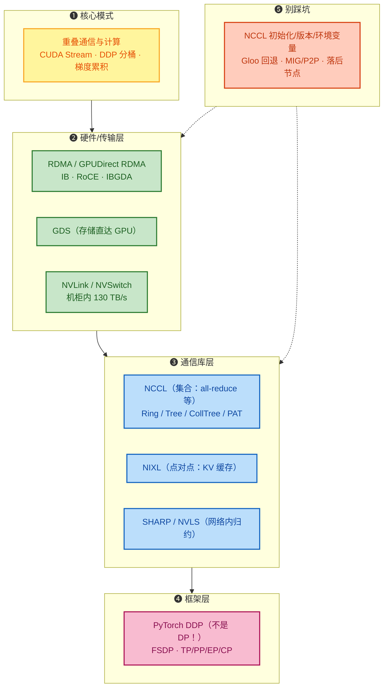
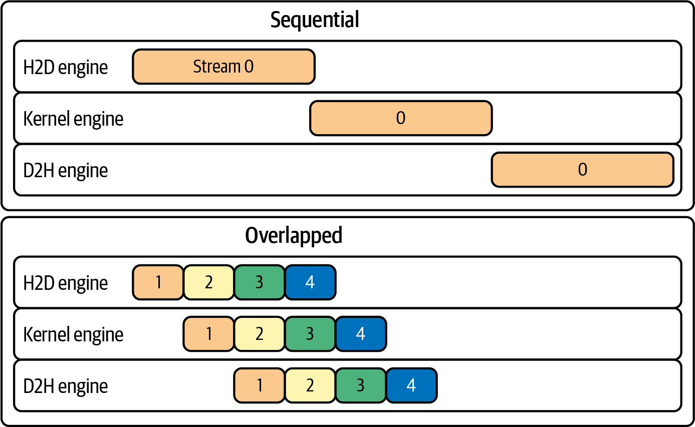
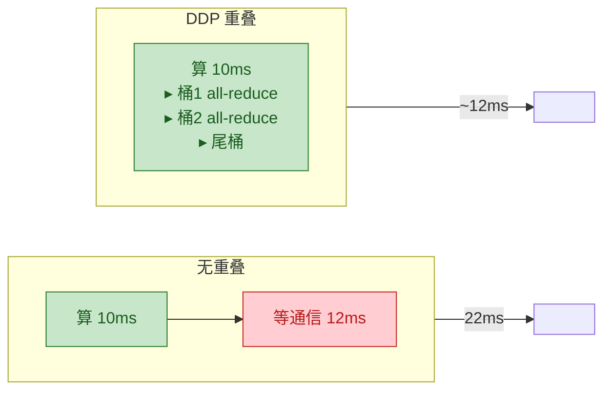
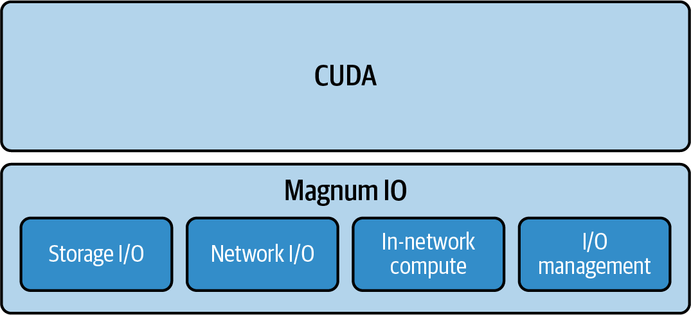
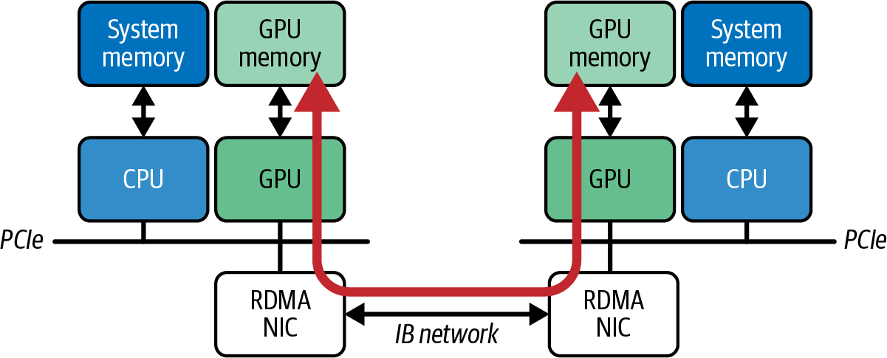
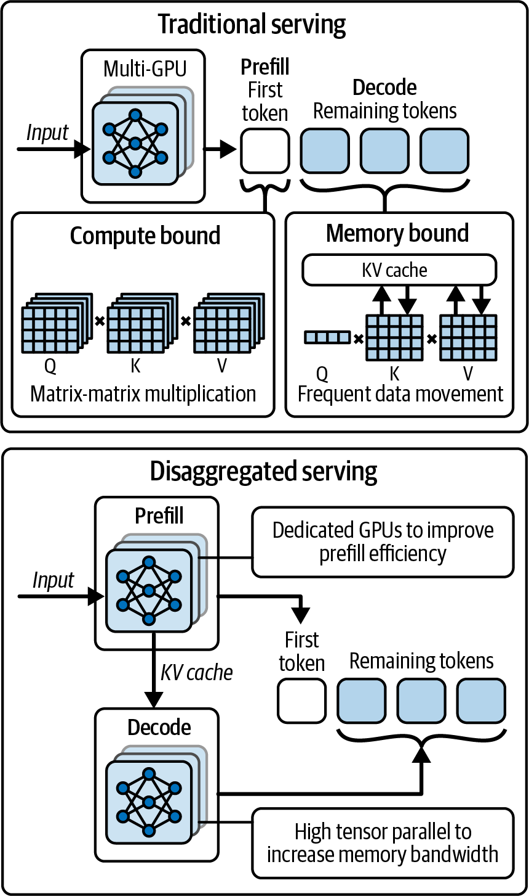
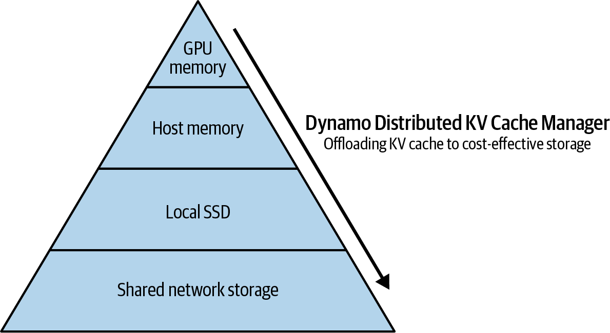
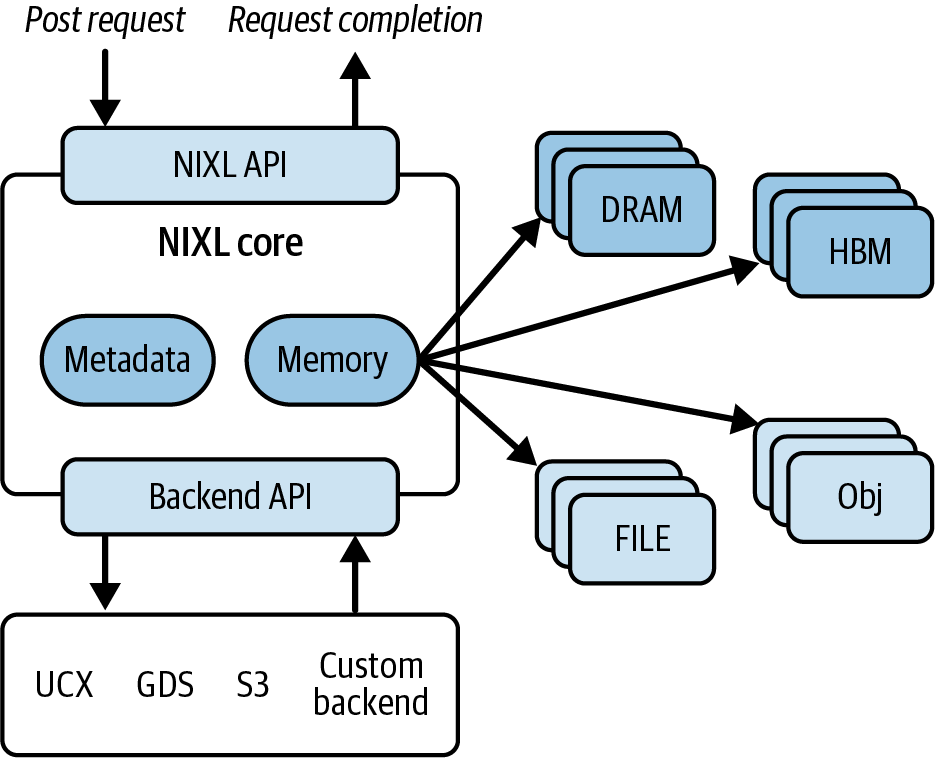
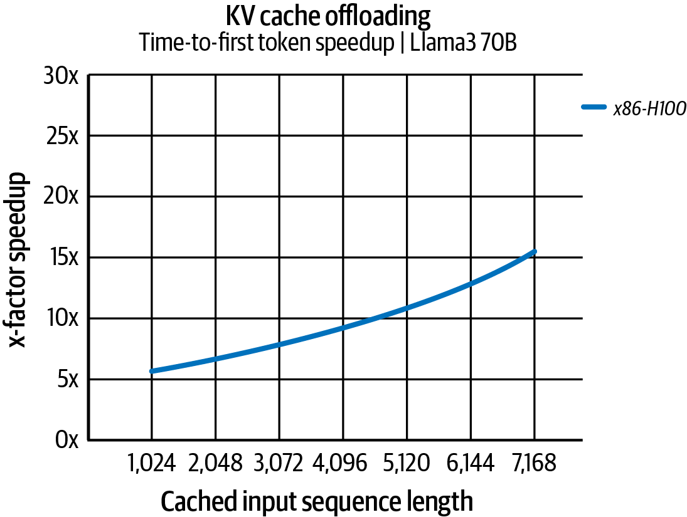

# 第 4 章 复习与自测 · 调优分布式网络通信

> **本笔记的用法**
> 第一部分「深度精读」按"是什么 → 为什么 → 怎么做 → 启示"四层重构全章，配书中原图；第二部分「自测」用分层题目检验你能否*讲清机制*而非*背下结论*。
> 建议流程：先盖住答案做自测 → 再读精读补漏 → 最后用文末「一页速查」做长期记忆锚点。

---

## 目录

- [0. 全章思想地图](#0-全章思想地图)
- [1. 核心模式：重叠通信与计算](#1-核心模式重叠通信与计算)
- [2. Magnum IO 加速栈](#2-magnum-io-加速栈)
- [3. RDMA / GPUDirect：绕过 CPU 的零拷贝传输](#3-rdma--gpudirect绕过-cpu-的零拷贝传输)
- [4. 多节点调优与六大陷阱](#4-多节点调优与六大陷阱)
- [5. NCCL：集合通信的引擎](#5-nccl集合通信的引擎)
- [6. DDP vs DP：为什么 DP 已基本退役](#6-ddp-vs-dp为什么-dp-已基本退役)
- [7. NCCL 通信器生命周期与环境变量陷阱](#7-nccl-通信器生命周期与环境变量陷阱)
- [8. SHARP / NVLS：把归约搬进交换机](#8-sharp--nvls把归约搬进交换机)
- [9. NIXL：为推理而生的点对点传输](#9-nixl为推理而生的点对点传输)
- [10. 分层自测](#10-分层自测)
- [11. 一页速查](#11-一页速查)

---

## 0. 全章思想地图

第 4 章解决的问题很直白：**GPU 再强，等数据就是废铁**。整章围绕一条主线展开——**让通信尽量被计算隐藏**，并在硬件、库、框架三层把这条路打通。



> **一句话主旨**：GPU 集群扩展性的天花板几乎总是通信；用 NCCL/NIXL/RDMA/SHARP 这些工具，把集合通信藏在反向计算底下、把点对点传输变成 GPU 直连，**让 goodput 逼近"光速"**。

---

## 1. 核心模式：重叠通信与计算

**思想**：数据传输不要"等它传完再算"，而是让传输在后台发生，GPU 继续算别的。这是整章（乃至整本书）出现频率最高的模式。



> **图 4-1 解读**：4 个 CUDA Stream 并发执行。一个流做 H2D、一个做 D2H、一个做计算 kernel——彼此错开，**GPU 永远在忙**，没有大块"纯等传输"的灰色空闲。

**PyTorch DDP 自动帮你做这些事**（反向传播过程中）：
1. **分桶（bucketing）**：把小张量聚成 ~25 MB 的桶；
2. **桶就绪即启动**：某桶梯度算完，立即在独立通信流上启动异步 NCCL all-reduce，默认流继续算后续层；
3. **反向结束时大部分 all-reduce 已完成**——仅剩"尾部"；
4. 总迭代时间 ≈ **max(计算, 通信)**，而不是 计算 + 通信。

**数字示例（书中）**：F+B 计算 10 ms + 梯度 all-reduce 12 ms
- 无重叠 → ~22 ms
- 完全重叠 → ~12 ms（节省约 30–45%），SM 利用率 60% → 90%。



**让重叠更大的四件武器：**

| 武器 | 机制 | 权衡 |
|---|---|---|
| **更大 batch / 梯度累积** | 通信频率↓，每次同步间计算更多 | 有效 batch 变大，影响收敛；用显存换时间 |
| **梯度压缩 / 稀疏化** | 传输字节↓ | 算法可能损失精度；常需 layerwise 修正 |
| **分桶大小** | 桶大带宽高、但通信启动晚；桶小启动早但 NCCL 调用开销大 | PyTorch 默认 25 MB；大层可调大、小层可调小，**实测选最优** |
| **异步预取** | 数据/权重提前搬到 GPU | 占显存；需要流水线 |

> **禁忌**：不要在训练循环里随便调 `.item()`、`.cpu()`、`torch.cuda.synchronize()`——这些会强制全局同步，把重叠的流水线一刀砍断（典型出现在加 `print` 调试时）。

---

## 2. Magnum IO 加速栈

NVIDIA 把存储→网络→网络内计算→I/O 管理整套加速平台叫 **Magnum IO**。



> **图 4-2 解读**：Magnum IO 在 CUDA 之下分四块：
> - **Storage I/O**：GPUDirect Storage (GDS)、BlueField SNAP——NVMe 直达 GPU；
> - **Network I/O**：GPUDirect RDMA、NCCL、NVSHMEM、UCX、HPC-X；
> - **In-network compute**：SHARP（IB 交换机内归约），BlueField DPU 上跑子网/SHARP 管理；
> - **I/O management**：NetQ、UFM 遥测诊断。
> **关键事实**：以太网（RoCEv2）可以跑 RDMA，**但没有 SHARP**——这是大规模选 InfiniBand 的重要理由之一。

---

## 3. RDMA / GPUDirect：绕过 CPU 的零拷贝传输

**传统 TCP/IP 路径**：NIC → 主机内核缓冲 → 用户缓冲 → cudaMemcpy → GPU。CPU 参与每个包，多次拷贝。
**RDMA**：NIC 直接读写应用内存（zero-copy、kernel bypass、CPU 不参与）。
**GPUDirect RDMA**：NIC 直接 DMA 到 **GPU 显存**，完全绕过主机 RAM/CPU。



> **图 4-3 解读**：两端 GPU 通过 RDMA NIC 直接交换显存内容，中间 CPU 只在初始建立连接时出现，数据通路无 CPU 参与。

**延迟与带宽数量级（书中数字）**：
- 现代 IB RDMA：小消息 ~µs；大消息带宽可打满数百 Gbps；
- TCP/IP 以太：延迟 5–10× IB；典型 100 Gbps 或更低，还受内核开销限制。

**容器里最容易掉的坑：静默回退到 TCP**

容器没挂 `/dev/infiniband`、GID 不匹配、`nvidia_peermem` 没加载时，**NCCL 不报错**，悄悄回退到 TCP socket。吞吐量从数十 GB/s 掉到几 Gb/s（一个数量级以上），且没有显式错误。

**必做验证：**

```bash
lsmod | grep nvidia_peermem          # 确认 GPUDirect 内核模块加载
NCCL_DEBUG=INFO torchrun ...          # 看日志里是否走 NET/IB
ib_write_bw --use_cuda                # 端到端 GPU RDMA 带宽
bandwidthTest --memory=pinned         # 固定内存带宽基线
```

- 以太网没有 IB 时至少：**Jumbo frames MTU 9000**、调高 `net.core.rmem_max/wmem_max`、`net.ipv4.tcp_rmem/wmem`、换 BBR 拥塞控制；
- RDMA 虽然 CPU 不在数据通路，**但连接建立/完成事件仍在 CPU 上**——必须把 NIC 的 IRQ 绑到和 GPU/NIC 同 NUMA 节点的核（延续第 3 章 IRQ 亲和性）。

---

## 4. 多节点调优与六大陷阱

### 4.1 调优清单

1. **拓扑摸清**：`nvidia-smi topo -m`、`nvidia-smi nvlink`、Nsight Systems；NVL72 内 < 1 µs、130 TB/s——尽量把作业压在同一 NVLink 域；
2. **多用 RDMA/GPUDirect**：NCCL 自动选最快路径，但容器/权限错了就静默退化（见上节）；
3. **多轨（multirail）**：每节点多 NIC 时，NCCL 会跨 NIC 条带（例：2 × 800 Gbps = 1.6 Tbps、4 × = 3.2 Tbps），配 `NCCL_NSOCKS_PERTHREAD`/`NCCL_SOCKET_NTHREADS`（二者乘积 ≤ 64）；
4. **GPU 发起的网络**：IBGDA（InfiniBand GPUDirect Async）让 GPU 自己驱动 RDMA，不占 CPU；
5. **检查实际使用的接口**：`ibstat`/`ethtool -S`/`iftop`；一旦发现流量走错接口（例如跑在低速管理网）立刻定位。

### 4.2 六大陷阱（表格式记忆）

| # | 陷阱 | 现象 | 解法 |
|---|---|---|---|
| 1 | **Gloo 后端代替 NCCL** | 代码能跑但慢 1–2 数量级（400 MB all-reduce 200 ms vs 4 ms） | `backend="nccl"`，用 `torch.distributed.get_backend()` 验证 |
| 2 | **NCCL 版本不匹配** | hang 或静默回退慢路径 | 对齐 `nvidia-nccl-cu*` 包或对系统 NCCL 重编 PyTorch |
| 3 | **TCP 端口耗尽**（bootstrap） | 大集群握手失败 | 扩宽 `net.ipv4.ip_local_port_range`（例 50000–51000） |
| 4 | **带宽不足/NIC 错配** | 多节点反而比单节点慢（每 GPU 吞吐掉） | 多 NIC multirail；调 `NCCL_NSOCKS_PERTHREAD`/`NCCL_SOCKET_NTHREADS`（乘积 ≤ 64） |
| 5 | **落后节点（straggler）** | 全局被最慢者拖死 | 同构硬件、独占集群；用 `monitored_barrier(timeout=...)` + `NCCL_ASYNC_ERROR_HANDLING=1` 定位 |
| 6 | **UCX/RDMA 下 GPU 内存碎片** | 偶发分配失败/性能悬崖 | 监控 `torch.cuda.memory_reserved()` vs `memory_allocated()`，调整 PYTORCH_CUDA_ALLOC_CONF |

> **Gloo vs NCCL 实测对比（400 MB tensor, 800 Gbps IB）**：Gloo ≈ 2 GB/s（CPU 100%），NCCL ≈ **100 GB/s**（线速）——两个数量级差距，而且 NCCL 跑在 GPU 上，GPU 在通信期间也在干活。

---

## 5. NCCL：集合通信的引擎

**是什么**：NVIDIA 集合通信库，支撑几乎所有多 GPU 训练。提供 all-reduce、all-gather、reduce-scatter、broadcast、send/recv，自动选 PCIe/NVLink/NVSwitch/IB/TCP 中最快路径。

**NCCL 自动做拓扑感知**。典型例子：GPU 0-1 NVLink、GPU 2-3 NVLink，但跨对只走 PCIe——NCCL 会先在 NVLink 对内部归约，再跨 PCIe 做一次，再回灌，把慢链路数据量压到最低。手动指定算法用 `NCCL_ALGO=Ring,Tree,NVLSTree,PAT,CollTree,...`，默认就是最佳选择。

### NCCL 五大算法（按消息大小/拓扑选）

| 算法 | 形状 | 延迟 | 带宽 | 适用 |
|---|---|---|---|---|
| **Ring** | 环 | O(N) 跳 | **最优**（每链传 2·(N−1)/N ·B） | **大消息**（带宽主导） |
| **Tree / NVLSTree** | 生成树 | **O(log N)** | 叶子节点利用率低 | **小消息**（延迟主导）；NVLSTree 可触发 NVLS |
| **CollTree**（层次树） | 两级树（本地域 + 跨组） | O(log N) 跨组 | 本地用满带宽 | 中消息、跨节点；NVLink 域可走 SHARP/NVLS |
| **CollNet** | 本地环/树 + 全局树 | 跨组轮数少 | 同上 | 超大集群 |
| **PAT**（并行聚合树） | **Ring + Tree 流水线混合** | 分段 O(log N) | **接近 Ring** | **两全其美**：大消息高带宽 + 小延迟；现代 NCCL 默认常用 |

### 实测差异（拓扑感知前后）
- 朴素单环 all-reduce（跨 PCIe 交换机链路）：~数十 GB/s、SM 利用率 60%、迭代 100 ms；
- 拓扑感知层次算法：~**数百 GB/s**、SM 利用率 90%、迭代 70 ms（−30%）。

> 经验：**快链路上尽量多传，慢链路上尽量少传**。NVL72 机柜内所有 GPU 在同一 NVSwitch 域，NVLink 双向聚合 ~130 TB/s、<1 µs——作业首选机柜内。

---

## 6. DDP vs DP：为什么 DP 已基本退役

| 维度 | `nn.DataParallel`（DP） | `DistributedDataParallel`（DDP） |
|---|---|---|
| 进程模型 | 单进程多线程 | **每 GPU 一进程** |
| GIL | 被 Python GIL 序列化 kernel 启动 | 无 GIL 争用 |
| 通信 | 梯度聚到 GPU0 再广播（集中瓶颈） | NCCL all-reduce，**反向中重叠** |
| 扩展性 | 2–4 GPU 后迅速劣化 | 线性扩展到数千 GPU |
| 通信与计算 | 不重叠 | 分桶 + 独立通信流自动重叠 |
| 代码复杂度 | 一行 wrapper，简单 | 要 `init_process_group` + spawn/`torchrun` |

**实测**（书中小模型 2 GPU）：DP 45 ms/iter，DDP **30 ms/iter**（快 33%）。大模型/多节点差距更大。

**结论**：PyTorch 官方**明确推荐任何严肃多 GPU 训练都用 DDP**。DP 只剩"2 卡快速原型"场景。FSDP（第 13 章）则把参数/梯度/优化器状态也分片，进一步省显存。

---

## 7. NCCL 通信器生命周期与环境变量陷阱

### 7.1 通信器只初始化一次

`ncclCommInitRank` / `init_process_group` 是**全对全握手 + 建环/树 + 分配缓冲**的重操作。在每次迭代里反复创建/销毁，会把几毫秒的 all-reduce 埋在几十毫秒的初始化里——书中例子 48.5 ms/iter → 0.5 ms/iter（**−98%**）。

**规则**：
- 程序开始时初始化一次；
- 模型/流水线并行的子组用 `new_group()` 一次性创建并复用；
- 需要批量建多个通信器时用 C++ 的 `ncclGroupStart/End` 合并开销。

### 7.2 环境变量——默认值通常最好，乱改要留档

| 变量 | 作用 | 谨慎点 |
|---|---|---|
| `NCCL_DEBUG=INFO` | 记录路径/接口/回退 | 生产别开 DEBUG，开销大；默认 WARN |
| `NCCL_SOCKET_IFNAME=ib0` | bootstrap 走哪个接口 | 多 NIC 必设，否则可能走慢速管理网 |
| `NCCL_ASYNC_ERROR_HANDLING=1` | 异步错误中止，避免 hang | 显式设，别依赖默认 |
| `NCCL_P2P_DISABLE=1` | 禁 GPU 直连 P2P | **只能临时调试**，开着会让节点内流量走 CPU 缓冲，从数百→数十 GB/s |
| `NCCL_SHM_DISABLE=1` | 禁共享内存 | 同上，调试用 |
| `NCCL_BUFFSIZE` | 每通道缓冲（默认 4 MB） | 大消息可调，但注意显存压力 |
| `NCCL_NSOCKS_PERTHREAD` × `NCCL_SOCKET_NTHREADS` | 多 NIC 并行连接数 | **乘积 ≤ 64**（NVIDIA 限制） |
| `NCCL_ALGO` | 强制算法（Ring/Tree/...） | 默认最优，仅排障时改 |
| `NCCL_TOPO_FILE` / `_DUMP_FILE` | 显式拓扑/导出拓扑 | 复杂云环境或复现实验用 |
| `NCCL_IGNORE_CPU_AFFINITY=1` | 让 NCCL 线程自行在 NUMA 域内分布 | **绑核 + 设这个**，防止 NCCL 线程全挤单核 |

**NUMA 绑定推荐做法**：用 numactl 把每个 GPU 进程绑到本地 NUMA 域的核，再 `NCCL_IGNORE_CPU_AFFINITY=1` 让 NCCL 自己在域内微调线程位置。

**忽视日志 = 浪费钱**：`NCCL DEBUG=INFO` 里出现 `unable to enable P2P, falling back to copy`、`NET/Socket: using Ethernet interface eth0` 都是在喊"我没走上快车道"，必须处理。

### 7.3 规模上的可靠性（Meta Llama 3 405B，54 天中断统计）

| 故障源 | 占比 |
|---|---|
| GPU 故障 / HBM / SRAM / 热接口 / 处理器 / 静默损坏 | ~60% |
| 网络交换机/电缆 | 8.4% |
| 软件 bug | 12.9% |
| 其他（NIC/SSD/电源/CPU/内存等） | <20% |

GPU 相关故障占近六成——这是大规模训练必须做检查点、错了重试、异步错误处理的物理原因。

---

## 8. SHARP / NVLS：把归约搬进交换机

**思想**：all-reduce 不必等所有数据都到 GPU 再算。把归约（加法）放到**交换机硅片**里做，数据在网络里就被累加完。NVIDIA 叫 SHARP（Scalable Hierarchical Aggregation and Reduction Protocol）。

- **InfiniBand**：SHARP Aggregation Manager + Quantum 交换机固件；NCCL 通过 `nccl-rdma-sharp-plugins` 启用；
- **NVLink/NVSwitch 域（NVL72）**：等价技术叫 **NVLS（NVLink SHARP）**；CollTree/NVLSTree 算法会自动利用。

**为什么快**：
- 传统 ring reduce-scatter：每 GPU 在 (n−1) 跳里接收 B·(n−1)/n 字节；
- SHARP：交换机直接给每个 GPU 返回 B/n 字节——**每端接收量降为 1/(n−1)**；
- all-gather 走硬件多播，发送端发一次、网络复制；
- reduce-scatter + all-gather 流水线**并行** → 带宽受限阶段总时间 ≈ max 而非 sum，降 ~50%；
- 大集群实测 all-reduce **2×–5× 加速**。

**注意**：
- SHARP 不是默认开，要装插件/配置聚合管理器/加载 `nvidia_peermem`；
- Ethernet Spectrum-X **没有** SHARP（到目前为止），它靠拥塞控制/自适应路由提升 NCCL；
- 交换机归约缓冲有限，超大规模消息可能回退到普通路径，用 `NCCL_DEBUG` 监控 + 告警；
- 用 `ncclCommRegister()` 注册持久化用户缓冲，避免内部暂存拷贝。

---

## 9. NIXL：为推理而生的点对点传输

**定位**：NCCL 训练场景里"多对多集合"，NIXL（NVIDIA Inference Xfer Library，2025 开源）则是推理场景里的"一对一/一对少"大消息（KV 缓存）传输——**补充而非替代** NCCL。

### 9.1 为什么推理需要新库？

Transformer 推理天然两阶段：




> **图 4-6 解读**：上"单体"= 每个 GPU 既做 prefill 又做 decode，资源互相挤；下"分离式（disaggregated）"= prefill 集群专做计算、decode 集群专做带宽敏感的生成，中间靠**低延迟 KV 传输**衔接。这就要求一个"GPU 到 GPU 大消息快传"的库——NIXL。

### 9.2 NIXL 的特性





> **两张图解读**：NIXL 把 KV 缓存在 GPU HBM → CPU DRAM → NVMe → 对象存储之间按需搬，自动选最快链路；统一异步 API，后端由 UCX 抽象（NVLink/NVSwitch/IB/RoCE/PCIe/GDS），且支持 GPUDirect RDMA + IBGDA（GPU 自己发起传输）。

| 维度 | NCCL | NIXL |
|---|---|---|
| 主要用途 | 训练集合（all-reduce 等，多对多） | 推理点对点/一对少（KV 缓存搬移） |
| 模式 | 同步集合（屏障） | **异步**传输 + 回调/轮询 |
| 路径自动选择 | 是 | 是（互连无关） |
| 数据规模 | 小到中等张量（梯度） | 大消息（数百 MB+，KV 缓存） |
| 典型场景 | DDP/FSDP 梯度同步 | prefill→decode KV 交接、KV 卸载 |
| 与计算重叠 | 依赖 DDP 多流 | 原生设计目标 |



> **图 4-9 解读**：x86+H100 系统上，用 KV 缓存卸载（把不活跃 KV 搬到 CPU/SSD），长序列 TTFT（首 token 时间）比"重新计算 KV"快**最多 14 倍**。Grace Hopper 用 900 GB/s NVLink-C2C 又再 2 倍 → 相对 x86+H100 总共约 28×。

### 9.3 NIXL 使用骨架（C++）

```cpp
nixl_agent_config cfg;  cfg.backends = {"UCX"};  cfg.thread_safe = true;
nixlAgent agentSrc("src", cfg), agentDst("dst", cfg);

// 注册 GPU 显存（零拷贝、可持久复用）
nixl_desc_t d{addr, bytes, devId, VRAM_SEG};
auto srcRegs = agentSrc.registerMem({d});
auto dstRegs = agentDst.registerMem({d});
auto sx = srcRegs.trim(), dx = dstRegs.trim();

nixlReqH h;
agentSrc.prepXfer(NIXL_WRITE, sx, dx, "dst", h);
agentSrc.postXfer(NIXL_WRITE, sx, dx, "dst", h);   // 非阻塞，立即返回
// ... 继续做别的计算 ...
while (agentSrc.checkXfer(h) == NIXL_INPROGRESS) std::this_thread::yield();
```

关键四步：`registerMem` → `trim` → `prepXfer/postXfer` → `checkXfer`。完全异步、零中间拷贝、自动选最快路径。NVIDIA Dynamo 用 NIXL 在 72-GPU NVL72 上对 ~680B LLM 拿到 **30× 推理吞吐**。

---

## 10. 分层自测

> 先独立作答，再点开 `<details>` 对照。

### A · 核心机制

<details>
<summary><b>Q1.</b> "重叠通信与计算"到底是什么意思？DDP 怎么帮你做到？</summary>

把数据传输放到后台 CUDA stream 异步跑，同时默认 stream 继续反向计算。DDP 在反向时把梯度分成 ~25 MB 桶，某桶就绪立刻在通信流上异步启动 NCCL all-reduce，默认流继续算后续层；反向结束时只剩最后一个桶未完成。迭代时间从"计算+通信"变成"max(计算,通信)"。
</details>

<details>
<summary><b>Q2.</b> GPUDirect RDMA 比传统 TCP 快在哪？为什么容器里会"静默回退"？</summary>

RDMA NIC 直接 DMA 到 GPU 显存，绕过内核/CPU/主机 RAM，零拷贝、kernel bypass、CPU 不参与数据通路，延迟 µs 级、带宽打满链路。容器没挂 `/dev/infiniband`、GID 不匹配、`nvidia_peermem` 没加载时，NCCL 不报错直接走 TCP socket，吞吐从数十 GB/s 掉到几 Gb/s。要用 `NCCL_DEBUG=INFO`、`lsmod | grep nvidia_peermem`、`ib_write_bw --use_cuda` 验证。
</details>

<details>
<summary><b>Q3.</b> Ring 和 Tree all-reduce 各自适合什么场景？PAT 为什么"两全其美"？</summary>

- Ring：带宽最优（每链传 2·(N−1)/N ·B），但 O(N) 跳延迟高 → **大消息/带宽主导**。
- Tree：O(log N) 跳延迟低，但叶子链路利用不均 → **小消息/延迟主导**。
- PAT（并行聚合树）：把大消息切成块，每块独立走 tree reduce-scatter，各块流水线交错启动 → 每段延迟 O(log N)，链路持续被填满 → 接近 Ring 的带宽 + Tree 的低延迟。
</details>

<details>
<summary><b>Q4.</b> SHARP/NVLS 为什么能快到 2–5×？"在网络里计算"具体是什么意思？</summary>

SHARP 把归约算术做进交换机硅片（IB 的 SHARP，NVSwitch 的 NVLS）。数据流经交换机时就地累加，每个 GPU 只收到 B/n 而不是 B·(n−1)/n；all-gather 走硬件多播。带宽受限阶段 reduce-scatter + all-gather 并行后总时间从"和"变成"max"，再加上减少端点跳数，大规模上加速显著。
</details>

<details>
<summary><b>Q5.</b> NIXL 和 NCCL 的区别，一句话讲清。</summary>

NCCL 是为"训练时多 GPU 同步集合（all-reduce 等）"设计的多对多库；NIXL 是为"推理时跨 GPU/CPU/存储搬大块 KV 缓存"设计的异步点对点库，自动选最快链路、原生支持与计算重叠。NIXL 不替代 NCCL，二者互补。
</details>

### B · 实战陷阱

<details>
<summary><b>Q6.</b> 为什么用了 Gloo 后端训练会"看起来正常但慢 100 倍"？怎么快速发现？</summary>

Gloo 走 CPU + TCP socket，集合操作在 CPU 内存上跑，GPU 通信期间基本空闲；400 MB tensor 实测 Gloo ≈ 2 GB/s（CPU 100%）、NCCL ≈ 100 GB/s（线速）。代码能跑不出错。用 `torch.distributed.get_backend()` 确认，或 `NCCL_DEBUG=INFO` 里根本没有 NCCL 日志就说明走错了。多 GPU 训练必须 `backend="nccl"`。
</details>

<details>
<summary><b>Q7.</b> 列举至少 3 件会"意外破坏 DDP 通信/计算重叠"的代码行为。</summary>

- 在训练循环里调 `.item()` / `.cpu()` 隐式触发 `cudaDeviceSynchronize`；
- 显式调 `torch.cuda.synchronize()` 做不必要的全局同步；
- 每迭代反复 `init_process_group` / 销毁重建通信器；
- 任意 `print(loss)` 把 tensor 拉回 CPU；
- 把 `NCCL_P2P_DISABLE=1`、`NCCL_SHM_DISABLE=1` 留在生产环境（调试用开关）。
</details>

<details>
<summary><b>Q8.</b> `NCCL_IGNORE_CPU_AFFINITY=1` 为什么推荐和 numactl 绑核一起用？</summary>

numactl/`taskset` 把进程绑到本地 NUMA 域保证局部性，但绑得太窄会让 NCCL 的后台通信/轮询线程全挤到一个核上，吞吐下降。设这个变量让 NCCL 在继承的 NUMA 域内自由分布线程，既保留局部性又获得充足并行。
</details>

<details>
<summary><b>Q9.</b> 多 NIC 场景下两个 NCCL 线程/套接字变量的硬性上限是什么？为什么？</summary>

`NCCL_NSOCKS_PERTHREAD × NCCL_SOCKET_NTHREADS ≤ 64`。这是 NCCL 对单通信器允许的 TCP 套接字/线程总数上限，防止 CPU/网络资源被打爆。多 NIC 时逐步加（如 2 线程 × 2 套接字 = 4 连接），边调边测。
</details>

<details>
<summary><b>Q10.</b> Meta Llama 3 405B 54 天预训练中断统计里，占比最高的故障源是什么？这指导我们做什么工程措施？</summary>

GPU 相关（GPU 故障/HBM/SRAM/热接口/处理器/静默损坏）合计近 60%，其次是软件 bug 13%、网络 8%。指导：频繁 checkpoint、用 `NCCL_ASYNC_ERROR_HANDLING=1` 和 `monitored_barrier` 快速定位失败 rank、做自动重试/恢复，而不是指望硬件完全不出错。
</details>

### C · 数字与拓扑

<details>
<summary><b>Q11.</b> 一个 2 节点 IB（800 Gbps = 100 GB/s）集群上 all-reduce 400 MB tensor，NCCL 理想耗时多少？相比 Gloo 快几倍？</summary>

400 MB / 100 GB/s ≈ **4 ms**（书中实测）；Gloo 约 200 ms → **50 倍**差距（两个数量级）。
</details>

<details>
<summary><b>Q12.</b> 每 iter 重建通信器 vs 一次初始化，书中例子差距多少？为什么？</summary>

48.5 ms → 0.5 ms（**−98%**）。通信器初始化要全对全握手、建环/树、分配缓冲，复杂度 worse-than-linear，32 GPU 可到分钟级；初始化一次后每 iter 只做极小开销的 all-reduce。
</details>

<details>
<summary><b>Q13.</b> 为什么分离式推理要把 prefill 和 decode 放到不同 GPU 集群？NIXL 在这里承担什么角色？</summary>

Prefill 计算密集（吃 Tensor Core/matmul），decode 带宽密集（吃 HBM 带宽，每步只算 1 token）。把它们混在同一 GPU 会互相干扰、吞吐下降。分离后 prefill 集群和 decode 集群各自按资源特征优化。NIXL 把 prefill 产出的 KV 缓存（几十到上百 GB）以高带宽、低延迟、GPU 直连的方式搬到 decode GPU，同时允许把冷 KV 卸载到 CPU/SSD/对象存储。
</details>

### D · 开放思考

<details>
<summary><b>Q14.</b> 你接手一个训练集群，发现扩展到 8 节点后每 GPU 吞吐反而下降。你按什么顺序排查？</summary>

参考顺序：
1. **先看是不是回退了**：`NCCL_DEBUG=INFO` 确认走 NET/IB 而非 Socket；`lsmod | grep nvidia_peermem`；是否有 P2P fall back 警告；`nvidia-smi topo -m`；
2. **看拓扑布局**：作业的 GPU 是否跨 NUMA / 跨 NVLink 域 / 跨机柜；必要时用 `NCCL_TOPO_FILE` 或调度器约束；
3. **看 NIC 是否饱和 / 数量**：`ibstat`/`ethtool -S`；若单 400 Gbps 被 Blackwell 打满，启用多 NIC multirail，调 `NCCL_NSOCKS_PERTHREAD`/`NCCL_SOCKET_NTHREADS`；
4. **看 straggler**：用 `monitored_barrier` + DCGM/IB 计数器找滞后节点（热节流/NIC 抖动/后台任务）；
5. **看 SHARP/NVLS 是否启用**：跨机柜时确认 SHARP 插件已装并命中；
6. **看代码层**：DDP 桶大小、有没有意外同步点、`NCCL_P2P/SHM_DISABLE` 是否遗留；
7. **最后才考虑算法**：必要时 `NCCL_ALGO` 对比实测。
</details>

---

## 11. 一页速查

**通信与计算重叠的四把斧**：更大 batch / 梯度累积、分桶（PyTorch DDP 默认 25 MB）、梯度压缩/稀疏、异步预取。**禁忌**：`.item()` / `.cpu()` / 无端 `torch.cuda.synchronize()`。

**Magnum IO 四支柱**
- Storage I/O → GDS / BlueField SNAP
- Network I/O → GPUDirect RDMA / NCCL / NVSHMEM / UCX
- In-network compute → SHARP (IB) / NVLS (NVSwitch)
- I/O management → NetQ / UFM

**RDMA 验证清单**：`lsmod | grep nvidia_peermem`、`NCCL_DEBUG=INFO`（看到 NET/IB）、`ib_write_bw --use_cuda`、`bandwidthTest --memory=pinned`；以太网侧 MTU 9000 + tcp buffer + BBR。

**六大陷阱**：Gloo 后端 / NCCL 版本不匹配 / TCP 端口耗尽 / 带宽不足或 NIC 错配 / Straggler / GPU 内存碎片。

**NCCL 五算法**：Ring（大消息带宽优）、Tree/NVLSTree（小消息低延迟）、CollTree（两级树）、CollNet（本地+全局）、PAT（Ring+Tree 流水线，两全其美）。

**NCCL 环境变量（精选）**

| 变量 | 要点 |
|---|---|
| `NCCL_DEBUG=INFO` | 排障必开，生产默认 WARN |
| `NCCL_SOCKET_IFNAME=ib0` | bootstrap 走高速接口 |
| `NCCL_ASYNC_ERROR_HANDLING=1` | 错误不 hang |
| `NCCL_P2P_DISABLE=1` / `NCCL_SHM_DISABLE=1` | 仅调试用，别留生产 |
| `NCCL_ALGO=...` | 默认最优，排障再覆盖 |
| `NCCL_NSOCKS_PERTHREAD` × `NCCL_SOCKET_NTHREADS` | 多 NIC，**乘积 ≤ 64** |
| `NCCL_IGNORE_CPU_AFFINITY=1` | 绑核 + 让 NCCL 自己在 NUMA 域分布线程 |
| `NCCL_SHARP_DISABLE=1` | A/B 对比 SHARP 用 |

**DDP vs DP**：永远用 DDP（每 GPU 进程、NCCL、反向中重叠）。DP 单进程受 GIL 限，梯度聚到 GPU0，扩展性差，只适合 2 卡原型。

**SHARP**：归约进交换机 → all-reduce 2–5×；IB 用量子级交换机 + NCCL RDMA SHARP 插件；NVL72 内等价是 NVLS；交换机缓冲有限可能回退。

**NIXL vs NCCL**：NCCL = 训练集合（多对多、同步）；NIXL = 推理点对点（大 KV、异步、互连无关）。NIXL 用 UCX 抽象 + GPUDirect RDMA + IBGDA；KV 卸载给长序列 TTFT 带来最多 14×（x86+H100）→ 再 2×（Grace Hopper NVLink-C2C）；Dynamo 上 72-GPU NVL72 对 680B LLM 达 30× 推理吞吐。

**NIXL 关键 API**：`registerMem` → `trim` → `prepXfer/postXfer` → `checkXfer`。

**术语快查**：CUDA Stream · 分桶 bucketing · 梯度累积 · Magnum IO · RDMA · RoCEv2 · GPUDirect RDMA/Storage (GDS) · IBGDA · NCCL（Ring/Tree/CollTree/CollNet/PAT）· NVLS / SHARP · all-reduce / reduce-scatter / all-gather · DDP vs DP · FSDP · Straggler · NIXL · disaggregated prefill/decode · KV cache · UCX · Dynamo · TTFT

**自查清单**
- [ ] 能在白板画出"重叠 vs 串行"时间线，讲清 DDP 分桶机制
- [ ] 能复述 GPUDirect RDMA 的数据通路，以及容器静默回退的识别方法
- [ ] 能按消息大小/拓扑选择 NCCL 算法，讲清 PAT 为什么两全其美
- [ ] 能说出 NCCL 六个陷阱及对应一条检测命令
- [ ] 能对比 DDP/DP、NCCL/NIXL、SHARP/NVLS 三组易混概念
- [ ] 能讲清分离式推理 prefill/decode 为什么分开、NIXL 扮演什么角色
- [ ] 能给出多节点扩展掉速的排查顺序
